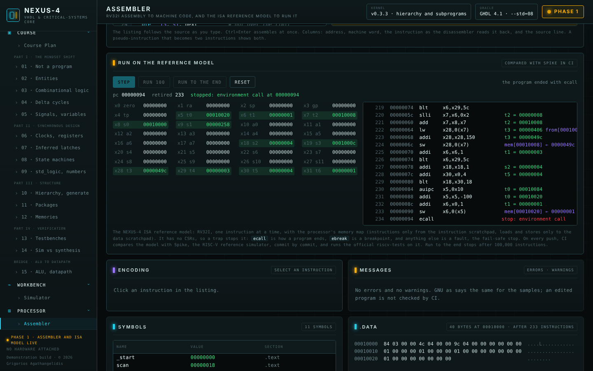

# NEXUS-4 — Critical-Systems Processor & VHDL Workbench

**A single-file VHDL course, a time-predictable RISC-V processor for critical systems, and a hardware guardian that checks formal properties while the processor runs.**

[](LICENSE)


[](https://github.com/gregory82gr/Nexus-4-phase-0/actions/workflows/differential.yml)

> **Status: Phase 0 complete; Phase 1 in progress.** What exists today:
> - the console (`index.html`: overview, simulator, course plan, assembler, verification, roadmap, About),
> - **the whole course, chapters 1–15**, live, with workbenches in the text and drills graded by the oracle (see [Chapters](#chapters)),
> - the **simulator workbench**, live: a VHDL editor, waveforms and a delta-cycle inspector running on the kernel in the browser (see [The simulator workbench](#the-simulator-workbench-live)),
> - the **simulator kernel v0.3** (hierarchy, packages and subprograms; see [Kernel status](#kernel-status)), which agrees with GHDL delta cycle by delta cycle on all 41 examples,
> - the GHDL oracle tooling, its examples, and mutation checks that prove the tests can fail,
> - the **RV32I assembler**, live, which produces exactly the bytes GNU `as` produces, with a disassembler that prints what `objdump` prints (see [The assembler](#the-assembler-live)),
> - the **ISA reference model**, live on the same page, which agrees with Spike, the RISC-V reference simulator, instruction by instruction and passes the official riscv-tests for RV32I (see [The ISA reference model](#the-isa-reference-model-live)),
> - the GitHub Actions workflow that runs all of it on every push.
>
> The RV32I core in VHDL comes next in Phase 1. This README also describes the design that has been decided; a feature exists only when the [roadmap](#roadmap) marks it as available.

NEXUS-4 will run entirely in the browser from one `index.html`, like its siblings. It has three parts that build on each other:

1. **A complete, interactive VHDL course.** It is written for software engineers who can program but have never designed hardware. It runs on its own VHDL simulator, written in JavaScript, which shows every delta cycle.
2. **A RISC-V processor at RTL level, for critical systems.** The core is RV32I, multi-cycle and in-order. It is written in VHDL and runs on the same simulator, next to a reference model of the instruction set that checks it on every instruction.
3. **A hardware guardian.** This is a small, hardwired unit derived from a formal specification. It watches the processor and steps in when a safety, bounded-liveness or idempotency property is violated, whether the cause is a design error or a radiation-induced bit flip.

NEXUS-4 is the fourth system in the NEXUS series:
- [NEXUS-1](https://github.com/gregory82gr/nexus1), the nuclear plant ([live demo](https://gregory82gr.github.io/Nexus-1-phase-0))
- [NEXUS-2](https://github.com/gregory82gr/Nexus-2-phase-0), the satellite constellation
- [NEXUS-3](https://github.com/gregory82gr/Nexus-3-phase-0), the shared-memory multiprocessor

It reuses their design language. Its processor is meant for the first two: the protection channel of the NEXUS-1 plant and the on-board computer of a NEXUS-2 satellite.

> **Simulation only.** NEXUS-4 is a demonstration and study tool. Its processor has not been synthesized for, or qualified on, any real device. It is not certified to any safety standard and must not be used to protect any real plant, vehicle or person. Standards are cited for orientation only (see [Standards awareness](#standards-awareness)).

---

## Why NEXUS-4

NEXUS-3 was about **hiding** time: out-of-order cores, caches, prefetching and latency tolerance. NEXUS-4 is about the opposite: making time **predictable**, and making a processor **checkable**.

In a critical system, being fast on average matters less than two other questions:
- Will this instruction sequence always finish within N cycles?
- Can we tell, while it runs, that the software still respects its specification?

NEXUS-4 is built around those two questions.

---

## Part 1 — The VHDL course (Phase 0)

### Approach

The course explains VHDL through ideas its readers already know:

| VHDL | Software analogy used in the course |
|---|---|
| Signal assignment | Recording an event: the change is scheduled, not applied |
| Delta cycle | A commit: all scheduled changes apply together and wake their handlers |
| Process | An event handler or projection that reacts to changes |
| Variable | Local state inside the handler, updated immediately |
| Finite state machine | The states of an aggregate |

### The simulator workbench (live)


The **Simulator** page runs the kernel in the browser. Pick one of the examples, or write your own design, and run it:
- **Editor.** Syntax highlighting and line numbers; `Ctrl+Enter` runs. A VHDL error, a run-time error or a construct the kernel does not support yet is reported with its line, and the line is marked.
- **Waveforms.** Two views of the same run. *Delta cycles* gives every simulation cycle its own column, so a zero-delay chain shows as a staircase at one point in time. *Time* is the usual waveform view, where the delta cycles of a time step collapse and only a small `×n` mark says they were there. Vectors are shown as buses (binary, hex or decimal; signed values in decimal) and expand into their scalar parts. The ports of instances, which are other names for signals already listed, are hidden unless *Ports* is on. A transaction that is not an event is marked with a dot, and a transaction GHDL leaves out (see [the calibrated exception](#continuous-integration-github-actions)) with a hollow dot.
- **Delta-cycle inspector.** For every cycle, the three phases of the simulation cycle: which drivers were updated (events, and transactions without events), which processes woke up and why, and what they did (the assignments they scheduled, with the time each value is due, and their messages). A short note explains the cycle in software terms.

The examples in the workbench are copies of `tests/examples/*.vhd`, embedded in `index.html` by `tools/embed-examples.mjs`, and CI fails if the copies differ from the files. So an unedited example in the workbench is exactly the file that CI has compared with GHDL; the page says so, and says "edited · not verified" as soon as you change it. A run stops after 5,000 cycles.

### Chapters


| Chapter | Status | What it uses |
|---|---|---|
| 1. Hardware is not a program | **live** | `trip_voter` (the 2-out-of-3 trip vote of a protection channel), `resolution_conflict`; a 5-question drill |
| 2. Entity and architecture | **live** | `two_architectures` (one entity, two implementations checked against each other), `port_initial_value`; a 5-question drill |
| 3. Combinational logic | **live** | `combinational`, `alarm_priority` (when/else versus with/select), `missing_sensitivity`; a 6-question drill |
| 4. The simulation kernel and delta cycles | **live** | `delta_chain`, `delta_glitch`, `swap_signals`; a 6-question drill |
| 5. Signals versus variables | **live** | `signal_vs_variable`, `last_assignment_wins`, `variable_persists`; a 6-question drill |
| 6. Clocks, flip-flops and reset | **live** | `unreset_register`, `clocked_counter`, `reset_styles`, `register_inference`, `edge_detection`; a 6-question drill |
| 7. Inferred latches | **live** | `inferred_latch` (latch, default assignment, clock enable); a 5-question drill |
| 8. State machines | **live** | `protection_fsm`, `fsm_safe_recovery` (an upset into an unused state code, recovered by `when others`); a 6-question drill |
| 9. std_logic and numeric_std | **live** | `wired_bus` (pull-up, open drain, weak conflict, `to_x01`), `numeric_std_traps`; a 6-question drill |
| 10. Hierarchy, generics and generate | **live** | `ripple_adder` (a generic adder by for-generate; the carry ripples one delta per stage), `hierarchy_ports`, `fault_profiles` (PLANT lockstep and ORBIT TMR by generic); a 6-question drill |
| 11. Packages, functions and procedures | **live** | `plant_package` (a reading record and fail-safe rules: an invalid sensor votes for the trip), `packages_subprograms`; a 6-question drill |
| 12. Memories and register files | **live** | `register_file`, `ram_read_timing` (asynchronous and synchronous reads, read during write), `aggregates_slices`; a 6-question drill |
| 13. Self-checking testbenches | **live** | `tb_self_check` (a table of cases, a check procedure, a summary), `assert_failure`, `wait_forms`; a 6-question drill |
| 14. Simulation versus synthesis | **live** | `timing_is_not_logic` (`after 30 ns` versus counting edges), `inertial_vs_transport`; a 6-question drill |
| 15. The ALU and the datapath | **live** | `alu_rv32` (the ten RV32I ALU operations, twelve test vectors), `datapath_step` (register file, ALU and PC, one instruction per clock); a 6-question drill |

A chapter is text plus live workbenches on examples from `tests/examples`, so every example a reader runs is one that CI compares with GHDL. The drill at the end of a chapter does not store its answers: each answer is computed from a run of its example, and `tools/course-check.mjs` checks in CI that every computed answer is one of the options and that every cycle the text points at exists. So the drills are graded by the oracle too.

Chapters 1–3 introduce the mindset with the plant's own logic: the 2-out-of-3 trip vote as an always-on circuit, one entity with two diverse implementations checked against each other, and an alarm annunciator that shows priority versus tables. Chapter 4 is the centre the rest of the course leans on: the simulation cycle (update, resume, execute), delta cycles that take no time, a delta glitch that a waveform viewer hides and the simulator does not, two processes that swap values without a temporary, and the difference between a transaction and an event. Chapter 5 builds on it: a variable changes at once and a signal in the next update, so `s <= s + 1` in a loop adds 1, the last assignment wins, and a process variable keeps its value between activations while a function's starts fresh.

### Planned structure

- **Part I, the mindset shift:**
  - hardware is not a program
  - entity and architecture as interface and implementation
  - combinational logic
  - the simulation kernel and delta cycles
  - signals versus variables
- **Part II, synchronous design:**
  - clocks, flip-flops and reset
  - inferred latches
  - state machines
  - the nine values of `std_logic` and `numeric_std`
- **Part III, structure:**
  - hierarchy, generics and `generate`
  - packages
  - memories and register files
- **Part IV, verification:**
  - self-checking testbenches
  - what becomes hardware and what exists only in simulation
- **Bridge:** from an ALU to a datapath, leading into Part 2.

Every chapter includes:
- live workbenches: editor, waveform viewer and delta-cycle inspector
- a "for the software engineer" box
- a "trap" box
- a scored drill, in the style of the Training Mode of NEXUS-2 and NEXUS-3, graded from verified runs

### The language subset

The simulator implements **VHDL-93 plus selected VHDL-2008 features**: `process(all)`, reading output ports, conditional assignment inside processes, reduction operators and `to_string`.

One rule decides what is in: a feature is supported if the processor or its testbench needs it, or if it is needed to teach a semantic trap. Examples:
- `std_logic` resolution is in, because a tri-state bus is too good a lesson to skip.
- Access types, file I/O and `textio`, configurations, protected types and generic packages are out.

Examples that need features outside the subset are shown as pre-computed GHDL runs, clearly marked as such.

---

## Part 2 — The processor (Phases 1 and 2)

### The assembler (live)


The **Assembler** page turns RV32I assembly into machine code as you type. The listing shows each address, machine word and source line, and the instruction as the NEXUS-4 disassembler reads it back; click an instruction and its bit fields are drawn, format by format. This is the first piece of the visual encoder of the assembly Help.

- **What it accepts.** All 40 instructions of the RV32I base (the 37 computational, load, store and control-transfer instructions, plus `fence`, `ecall` and `ebreak`; the CSR instructions belong to the Zicsr extension and are not part of the core), and the pseudo-instructions of the GNU assembler (`li`, `la`, `mv`, `not`, `neg`, `seqz`, `bgt`, `ble`, `j`, `call`, `tail`, `ret`, loads and stores to a symbol, and the rest), expanded the way GNU expands them. Directives: `.text`, `.data`, `.section`, `.globl`, `.equ` / `.set` / `=`, `.align` / `.p2align` / `.balign`, `.byte` / `.half` / `.word`, `.zero` / `.space`, `.ascii` / `.asciz` / `.string`, `.rept` / `.endr`. Expressions are evaluated in 64 bits, as GNU evaluates them, with `%hi`, `%lo`, `%pcrel_hi`, `%pcrel_lo`, and numeric local labels (`1b`, `1f`); several statements may share a line, separated by `;`.
- **Memory map.** Code starts at `0x00000000` and data at `0x00010000`, as the scratchpads of the processor will.
- **The oracle.** `tools/asm-check.mjs` assembles every program in `tests/asm` with both assemblers and links GNU's output with a two-line linker script for the same map. The `.text` and `.data` bytes must be identical, and so must every symbol address. Every line of `tests/asm/errors.txt` must be rejected by both. Then three random programs of 3,000 lines each and three sets of random constant expressions (fixed seeds) are compared the same way, and every instruction in the programs is disassembled by both NEXUS-4 and `objdump -M no-aliases,numeric`, which must print the same text. The official riscv-tests are a fourth corpus: all 40 rv32ui tests that NEXUS-4 runs assemble to identical bytes (see [The ISA reference model](#the-isa-reference-model-live)).
- **Where it is stricter than GNU, on purpose.** NEXUS-4 rejects an instruction at an address that is not a multiple of 4, padding in `.text` that is not whole instructions, a fill value for alignment in `.text`, a branch out of range, and a division by zero in an expression. GNU accepts all five: the branch it rewrites silently into the opposite branch over a `jal`, so the code grows by an instruction nobody wrote, and the division it replaces with a value of its own after a warning. `tests/asm/stricter.txt` lists them, and CI checks that GNU still accepts each one and NEXUS-4 still rejects it. Whatever both accept is byte-identical.
- **Mutation checks.** `tools/asm-mutations.mjs` breaks the assembler in 22 ways (rounding of the upper immediate, scattered B and J immediate bits, S-type halves, `srai`, the expansions of `li`, `ble`, `sgtz` and `call`, range checks, `x0` as a target of `la`, `.balign`, 32-bit instead of 64-bit expressions, the RV32 normalization of constants, the end of `.data`, `.rept`, `jr rs, imm`, and two disassembler decodings), and the comparison must fail on each. Its first run found two gaps: no test branched more than 2 KiB forward, and the `la x0` error case failed for the wrong reason; `tests/asm/long_branches.s` and a corrected error case close them.

The comparison found five differences while the assembler was written, all now followed: GNU accepts an immediate in place of the second source register of `add`, `and`, `or`, `xor`, `slt`, `sltu`, `sll`, `srl` and `sra` (but not `sub`) and assembles the I-type instruction; it rejects `la`, `lla` and loads from a symbol with `x0` as the target; it keeps the `addi` of `li x0, 0x12345000` that it leaves out for every other register; it accepts an empty `.byte`; and it rejects `.align` with more than three arguments.

The riscv-tests sources and the random expressions found five more. GNU on a 64-bit host evaluates expressions in 64 bits: a constant whose upper 32 bits are all 0 or all 1 is the sign extension of its low 32 bits, so `li a0, 0xfffffff0` is one `addi`, while any other constant keeps all 64 bits, so `li a0, 0x100000000` is `lui a0, 0`. It pads the end of `.text` to its alignment but not the end of `.data`. It accepts `jr rs, imm`, `jalr rs, imm` (linking through `ra`), `call rd, symbol` (through `t1`) and `jump symbol, rt`. And it has `.rept`.

### The ISA reference model (live)



The reference model is the specification the processor core will be held to: RV32I, one instruction at a time, in about 250 lines of JavaScript in `<script id="nexus4-isa">`. On the **Assembler** page, *Step*, *Run 100* and *Run to the end* run the assembled program on it. The registers it changed light up, every committed instruction is logged with the register it wrote and the memory it touched, and the `.data` panel shows the data scratchpad as the program left it.

- **The machine it describes.** Two scratchpads, as in the processor (Harvard): instructions are fetched only from the instruction scratchpad at `0x00000000`, loads and stores reach only the data scratchpad at `0x00010000`, 64 KiB each. There are no CSRs and no privilege modes, so a trap stops the machine, with the cause numbered as in `mcause`. `ecall` is how a program ends, `ebreak` is a breakpoint, and anything else (an illegal instruction, a misaligned access or jump target, an address outside the scratchpads) is a fault: the core stops, which for a protection channel is the fail-safe reaction.
- **Checked against Spike.** `tools/isa-check.mjs` assembles and links each program with GNU where Spike, the RISC-V reference simulator, expects memory (`0x80000000` and `0x80010000`), runs it on Spike with a commit log, and runs the same bytes on the model. Every committed instruction must match: pc, instruction word, the register written and its value, the memory address and the value stored. The programs are `tests/isa/*.s` and three random programs of about 7,000 executed instructions each (straight code, forward branches and jumps, `jalr` through `auipc`, short counted loops, loads and stores of every width). Spike is built from source at a pinned commit and cached in CI.
- **Traps.** Every case in `tests/isa/traps.txt` (34 of them: illegal encodings, misaligned loads, stores and jump targets, access faults, `ecall`, `ebreak`) must stop Spike and the model at the same instruction, with the same cause and the same `tval`.
- **Where it is stricter than Spike, on purpose** (`tests/isa/differences.txt`): `fence.i`, the CSR instructions, `wfi` and `mret` are illegal, because the core implements RV32I and nothing else; and loads or stores to the instruction scratchpad, or a jump into the data scratchpad, are access faults, because the scratchpads are separate. Spike, with one memory and the usual extensions, runs them all. CI checks that it still does and that the model still stops at the right instruction with the right cause.
- **The official riscv-tests.** `tools/riscv-tests.mjs` takes the rv32ui tests from [riscv-tests](https://github.com/riscv-software-src/riscv-tests) (fetched at a pinned commit, not copied here), expands them with the C preprocessor and a NEXUS-4 environment (`tests/riscv-tests/riscv_test.h`: no CSRs, the test ends with `ecall`), assembles each with the NEXUS-4 assembler and with GNU (the bytes must be identical) and runs it on the model. All 40 pass. Two are left out with their reasons: `fence_i` (Zifencei is not in the core) and `ma_data` (misaligned accesses trap on the core, and the test needs them to work or a trap handler).
- **Mutation checks.** `tools/isa-mutations.mjs` breaks the model in 25 ways (arithmetic and comparisons, signed and unsigned branches, `jal`/`jalr` links and targets, `auipc`, writes to `x0`, sign and zero extension of loads, store widths, byte order, the order of the alignment and access checks, the Harvard rule, decoding of `fence.i` and of shift encodings, `tval`, trap causes). Spike or the riscv-tests must catch each one. The first run found two gaps: a shift with an illegal `funct7` was accepted, and a `fence.i` that ran on was still reported as the expected stop, because the check did not look at where the model stopped. Both are closed.


### Core

| Aspect | Choice | Why |
|---|---|---|
| Instruction set | RISC-V RV32I subset | Small, open and formally specified. Its reserved custom opcode space holds the guardian's marker instructions |
| Microarchitecture | Multi-cycle, in-order | Each instruction class takes a fixed number of cycles, so worst-case execution time is a sum. The guardian sees one completed instruction at a time, with exceptions that point at an exact instruction |
| Memory | Scratchpad, no caches | No hit-or-miss timing to bound |
| Branches | No dynamic prediction | Same reason |
| Programs | Hand-written assembly | Through the NEXUS-4 assembler, with an extended assembly Help and a visual instruction encoder |

The reference model of the instruction set ([live](#the-isa-reference-model-live)) will run in the browser next to the RTL core. The two are compared after every instruction, so the reader can watch the implementation keep to its specification.

### Two fault-tolerance profiles (Phase 2)

The same VHDL design builds two profiles through generics and `generate`:

| | PLANT (NEXUS-1) | ORBIT (NEXUS-2) |
|---|---|---|
| Main threat | Systematic faults: design errors and common-cause failures | Random faults: single-event upsets and accumulated radiation dose |
| Mechanisms | Lockstep with comparator, watchdog, guardian mandatory | SEC-DED ECC on register file and memory with scrubbing, TMR on the program counter and control FSM, watchdog |
| On a detected fault | **Fail-safe**: trip | **Fail-operational**: safe mode |

The reader can flip any bit of the running processor and watch which mechanism catches it, or see that nothing does.

---

## Part 3 — The guardian (Phase 3)

NEXUS-4 follows a Simplex-style architecture:
- The **processor** is the complex channel that runs the control software.
- The **guardian** is a simple, hardwired, verified unit. It runs no software and steps in on any property violation, whatever the cause.

The guardian has to stay much simpler than what it guards. It is built only from:
- combinational invariant checks,
- small finite automata,
- counters,
- linear comparisons of a few values.

### What it checks

| Formal lens | Hardware form in the guardian | Status in plan |
|---|---|---|
| TLA+ invariants and temporal safety | Invariant checks and small automata over committed state | First |
| Bounded liveness ("within N cycles") | Deadline counters. A bounded liveness property is a safety property | First |
| Petri nets | Places as token counters, transitions as marker instructions; a transition that is not enabled is a violation | Second |
| Idempotency | Inside a declared idempotent region, a write to an address already read in that region is a violation | Third |
| Hoare contracts | Pre- and post-conditions at function entry and exit, restricted to linear comparisons | Fourth |

### What it cannot check

- **Unbounded liveness** ("eventually"). No run-time monitor can detect its violation in finite time.
- **Fairness**, for the same reason.

The course says so openly.

### How properties reach the guardian

- **Properties** are written in a small subset of TLA+ syntax, not in a new language. They are translated into automaton and counter tables that are loaded into the guardian.
- **A declared, meaning-preserving map** connects domain variables, such as rod position or trip state, to memory addresses and marker events. The guardian only sees bits; the map is what gives them meaning.

---

## Verification approach

No NEXUS-4 component is trusted without an independent oracle:

| NEXUS-4 component | Checked against |
|---|---|
| VHDL simulator (JavaScript) | [GHDL](https://github.com/ghdl/ghdl): every course example runs in both, and they must agree delta cycle by delta cycle |
| Assembler (JavaScript) | GNU binutils for RISC-V: identical bytes and symbols; the disassembler against `objdump` |
| RTL processor | The in-browser reference model of the instruction set, on every instruction |
| Reference model | Spike, the RISC-V reference simulator, commit by commit, in CI; the official riscv-tests (rv32ui) |

GHDL and binutils are used only during development. They are not part of `index.html`.

### Continuous integration (GitHub Actions)

The [differential tests workflow](.github/workflows/differential.yml) runs on every push and every pull request. It:
1. runs on `ubuntu-24.04`,
2. installs GHDL 4.1 and GNU binutils 2.42 for RISC-V (`binutils-riscv64-unknown-elf`) from the Ubuntu archive,
3. checks that the examples and assembler samples embedded in `index.html` are the current files (`node tools/embed-examples.mjs --check`),
4. runs `node tools/differential.mjs`,
5. checks the course: `node tools/course-check.mjs`,
6. runs `node tools/mutations.mjs`,
7. checks the assembler against GNU: `node tools/asm-check.mjs` (see [The assembler](#the-assembler-live)),
8. runs `node tools/asm-mutations.mjs`,
9. restores Spike from the cache, or builds it at its pinned commit, and fetches riscv-tests at theirs,
10. checks the ISA reference model against Spike: `node tools/isa-check.mjs` (see [The ISA reference model](#the-isa-reference-model-live)),
11. runs the riscv-tests: `node tools/riscv-tests.mjs`,
12. runs `node tools/isa-mutations.mjs`.

Any difference fails the build, and the badge at the top of this README shows the result of the latest run.

For every example in `tests/examples/`, the workflow does three things:

1. **It runs the example through GHDL** with `--std=08 --trace-signals`. After every simulation cycle, GHDL prints every scalar signal with its value and its event flag. Composite signals appear as their scalar parts, for example `m(1)(0)` or `r.n`. This is a delta-level ground truth, which VCD waveforms are not: VCD merges the delta cycles of a time step and cannot hold arrays of vectors.
2. **It checks GHDL against the example's own expectations.** These are the `-- @expect` lines in the file header, for example `-- @expect-event: .delta_chain(rtl).c1 @ 1ns +3`. This proves the oracle behaves as calibrated in the CI environment. The trace format is a debugging format, so the tools refuse any GHDL other than 4.1.x.
3. **It loads the NEXUS-4 kernel straight out of `index.html`** (from `<script id="nexus4-kernel">`, with no build step), runs the same example, and compares the two traces cycle by cycle. It compares:
   - cycle labels,
   - values,
   - active and event flags,
   - every message: `report` and `assert` messages, and also the warnings of the `ieee` library, such as `NUMERIC_STD."<": metavalue detected, returning FALSE`.

   Messages are compared as a set per time step, because the language does not fix the order in which processes run within one delta cycle.

The kernel grows construct by construct:
- **Pending.** An example that uses a construct the kernel does not support yet makes the kernel throw an error with the code `NEXUS4_UNSUPPORTED`, and the example is reported as **pending** rather than failed.
- **Required.** An example whose header says `-- @kernel: required` may never be pending. Once an example passes, it is marked required, so it cannot silently fall back.

**One calibrated exception.** Consider an inertial assignment that meets all of these conditions:
- it has a single zero-delay element,
- it gives a signal the value its driver already has,
- the driver has nothing else pending.

The VHDL standard still records a transaction for it, but nothing in the NEXUS-4 subset can observe that transaction, so GHDL leaves it out of its trace, including the delta cycle it would create. A delay, `transport`, a second waveform element or a pending transaction all make GHDL keep it. The kernel keeps these transactions and tags them, because the difference between a transaction and an event is part of the course. The comparison leaves out exactly the tagged ones. The `transaction_elision` and `unreset_register` examples pin this behaviour, so a change in a future GHDL would be caught.

**One known GHDL defect.** GHDL 4.1's trace sometimes leaves out the signals declared inside an `if ... generate` that has more than one alternative (`else` or `elsif`). Whether it does depends on the alternative chosen and on whether the condition is a constant or a generic, and `--disp-tree` crashes with "GHDL Bug occurred" on such designs. The kernel simulates these signals like any other and marks them *optional*: the comparison checks them whenever GHDL shows them and does not count them missing when it does not. Their effects on the signals outside the generate are always compared. The `fault_profiles` example exercises this.

**A second GHDL defect, found by the comparison.** GHDL 4.1 reads a constant array of records wrongly when the records are written as positional aggregates and a `std_logic` field comes before a `natural` one: in `(('1', 1, '0'), ('0', 2, '1'))` the second `natural` reads as 3. The NEXUS-4 kernel gets it right, and the differential test failed because the two disagreed. Named associations, or putting the `natural` field first, avoid it; the examples use named associations, which are clearer anyway. A minimal reproducer is recorded for an upstream report.

**Mutation checks.** A test suite that cannot fail proves nothing. `tools/mutations.mjs` breaks the kernel in 30 specific ways, and the differential tests must fail on every broken copy. The breakages cover:
- **the simulation cycle:**
  - inertial delay behaving like transport,
  - a wrong resolution function,
  - `rising_edge` ignoring the previous value,
  - a frozen delta counter,
  - immediate signal assignment,
  - a `failure` that does not stop the run,
  - no wake-up on events,
  - an ignored `wait until` condition,
  - missing transaction tagging;
- **composite values and `numeric_std`:**
  - a number instead of `'X'` for metavalues,
  - signed compared as unsigned,
  - missing metavalue warnings,
  - `to_hstring` without `To_X01`,
  - reversed concatenation,
  - swapped `to` / `downto`,
  - `case` ignoring its choices,
  - `exit` behaving like `next`,
  - zero instead of sign extension;
- **hierarchy and subprograms:**
  - instance paths without the entity name,
  - port drivers that start from the actual's value instead of the port's,
  - the for-generate index missing from names,
  - procedure waits that ignore signal parameters,
  - out variable parameters not copied back,
  - local bounds taken from the argument not set,
  - inverted string comparison (used by generics),
  - overloads resolved to the first declaration,
  - default parameter values ignored,
  - a selected assignment driving the wrong target;
- **0.3.2:** `to_x01` passing weak values through;
- **0.3.3:** a procedure writing its own frame instead of its process's variable.

Two of them survived their first run and exposed real gaps:
- `rising_edge` on a clock coming from `'X'` or `'Z'`, now covered by `edge_detection.vhd`;
- signed comparisons with negative numbers, now covered by `numeric_std_traps.vhd`.

The workflow runs these checks after the differential tests.

To run the tests locally (Linux with GHDL 4.1 and Node 22):

```bash
node tools/differential.mjs                                # all examples
node tools/differential.mjs tests/examples/delta_chain.vhd # one example
node tools/oracle.mjs tests/examples/delta_chain.vhd       # GHDL's parsed trace as JSON
node tools/mutations.mjs                                   # the tests must catch a broken kernel
node tools/embed-examples.mjs                              # after changing an example: copy it into index.html
node tools/course-check.mjs                                # the chapters' examples and drills
node tools/asm-check.mjs                                   # the assembler against GNU binutils
NEXUS4_SEED=7,8,9 NEXUS4_FUZZ=5000 node tools/asm-check.mjs # more random programs
node tools/asm-mutations.mjs                               # the GNU comparison must catch a broken assembler
SPIKE=~/spike/bin/spike node tools/isa-check.mjs           # the ISA model against Spike
RISCV_TESTS=~/riscv-tests node tools/riscv-tests.mjs       # the official rv32ui tests on the model
SPIKE=... RISCV_TESTS=... node tools/isa-mutations.mjs     # Spike and riscv-tests must catch a broken model
```

### Kernel status

| Version | Stage | Supported |
|---|---|---|
| 0.1.0 | Scalar signals | `std_logic` / `std_ulogic`, `boolean`, `integer` and its subtypes, `time`. Signals, variables and constants. Processes with sensitivity lists, `process(all)` or `wait` (on / until / for). Concurrent and conditional signal assignments. Waveforms with `after`, `transport` and inertial delay. Resolution of multiple drivers. `if`, `null`, `report`, `assert` (severity `failure` stops the run). `rising_edge`, `falling_edge`, `now`, `'event`, `'last_value`, `'image`, `to_string` |
| 0.2.0 | Composite types and `numeric_std` | User enumeration, integer, array and record types and subtypes. `std_logic_vector`, `std_ulogic_vector`, `unsigned`, `signed`. Composite signals split into scalar leaves, exactly as GHDL shows them. Indexing (also with a dynamic index), slices, record fields, as sources and as targets. Positional, named and record aggregates, string and bit-string literals, concatenation. Logical operators and reductions on vectors. `numeric_std`: `+`, `-`, comparisons, `to_integer`, `to_unsigned`, `to_signed`, `resize`, `shift_left`, `shift_right`, with the library's behaviour and warnings on `'U'` / `'X'`. `to_hstring`, `to_ostring`, `'length`, `'range`, `'left`, `'right`, `'high`, `'low`, `'pos`, `'val`. `case` (with full-coverage checking), `for`, `while` and plain loops with `exit` / `next` and labels |
| 0.3.0 – 0.3.2 | Hierarchy and subprograms | Several design units in one file. Entity instantiation (`entity work.x`) and component declaration plus instantiation. Generics with defaults, positional and named port and generic maps, `open` outputs, default and constant inputs. A port connected to a signal is the same signal under a second name, so both change in the same delta cycle (as GHDL shows). Instance paths exactly as GHDL names them (`.top(arch).u1@cell(rtl).a`). `for ... generate` and `if ... generate` with `elsif` / `else`, with local signals. `with ... select`. Packages and package bodies in `work`, with constants, types and subprograms. Functions and procedures: overloading, named association, default values, locals whose bounds come from the argument (`v'range`), `return`. Procedures with `signal` and `variable` parameters of mode in, out and inout that may `wait`. Object aliases. String comparison. The checks a compiler would make: a pure function may not read signals, a function may not wait, an input port may not be assigned. Recursion is not supported yet. 0.3.1 adds, for the workbench, a description of the design (signals with their scalar parts, processes with their lines) and an optional cycle limit; the simulation itself is unchanged. 0.3.2 adds `to_x01` from `std_logic_1164`. 0.3.3 lets a procedure declared in a process use that process's variables (the usual testbench `check` procedure), logs composite values readably, and describes the elements and fields of composite signals for the workbench |

**Speed (measured at v0.2):** about 20,000 rising clock edges per second for a 32-bit counter writing a 32 × 32 register file (1,057 signal bits), with snapshots and the event log turned off. Snapshots of every bit after every cycle are only taken for the tests.

## Roadmap

| Phase | Content | Status |
|---|---|---|
| 0 | VHDL simulator kernel and workbench, the VHDL course, GHDL differential tests | **Complete:** kernel v0.3 (hierarchy, packages, functions and procedures, `generate`), the simulator workbench, all 15 chapters of the course with oracle-graded drills, 41 examples compared with GHDL, mutation checks and CI |
| 1 | Assembler and assembly Help, reference model of the instruction set, multi-cycle RV32I core, processor views | **In progress:** the assembler is live (GNU-identical bytes, listing, bit fields), checked against binutils in CI; the ISA reference model is live, compared with Spike and passing riscv-tests rv32ui in CI |
| 2 | PLANT and ORBIT fault-tolerance profiles, fault-injection drills | Planned |
| 3 | The guardian, lenses in the order above | Planned |
| 4 (optional) | 5-stage in-order pipeline as a refinement of the multi-cycle core: same ISA, same tests, equivalence as the goal | Optional |

Each phase is meant to be complete and usable on its own.

---

## Standards awareness

NEXUS-4 is shaped by the following documents. It claims compliance with none of them.

| Document | Relevance |
|---|---|
| IEEE 1076 (VHDL) | The language. NEXUS-4 implements a documented subset |
| RISC-V Unprivileged ISA specification | The instruction set of the core |
| IEC 62566 | HDL-programmed devices in nuclear I&C performing category A functions. It treats microprocessors as outside its scope and stresses simplicity and determinism; this is why the guardian, not the processor, carries the safety role in the PLANT profile |
| ECSS-E-ST-20-40C, ECSS-Q-ST-60-03C | Space engineering and product assurance for ASIC, FPGA and IP cores (ORBIT profile) |

---

## Project structure

```text
index.html                          the whole application: HTML, CSS and JavaScript in one file
                                    (the simulator kernel is in <script id="nexus4-kernel">,
                                    the assembler in <script id="nexus4-asm">,
                                    the ISA reference model in <script id="nexus4-isa">)
tests/examples/*.vhd                example designs; each header names its top entity, stop time and expectations
tools/oracle.mjs                    runs GHDL and parses its delta-level trace
tools/kernel-runner.mjs             loads the kernel straight out of index.html into Node
tools/differential.mjs              checks GHDL against the expectations and compares it with the kernel
tools/mutations.mjs                 breaks the kernel on purpose; every broken copy must fail the tests
tools/embed-examples.mjs            copies tests/examples and tests/asm/*.s into index.html for the pages (--check: CI)
tools/course-check.mjs              checks the chapters: examples, highlighted cycles, drill answers computed by the kernel
tests/asm/*.s                       assembler programs; GNU as must produce the same bytes and symbols
tests/asm/errors.txt                lines both assemblers must reject
tests/asm/stricter.txt              lines GNU accepts and NEXUS-4 rejects on purpose, with the reasons
tools/asm-check.mjs                 compares the assembler and disassembler with GNU binutils for RISC-V
tools/asm-mutations.mjs             breaks the assembler on purpose; every broken copy must fail the comparison
tests/isa/*.s                       programs run on Spike and on the ISA model, compared commit by commit
tests/isa/traps.txt                 cases where both must stop with the same cause, at the same instruction
tests/isa/differences.txt           cases Spike runs and the NEXUS-4 core stops on, with the reasons
tests/riscv-tests/riscv_test.h      the NEXUS-4 environment for the official riscv-tests
tools/isa-check.mjs                 compares the ISA model with Spike
tools/riscv-tests.mjs               runs riscv-tests rv32ui through the assembler (and GNU) on the model
tools/isa-mutations.mjs             breaks the model on purpose; Spike or riscv-tests must catch every broken copy
docs/                               screenshots for this README
.github/workflows/differential.yml  runs the differential tests on every push and pull request
LICENSE                             MIT License
README.md                           this file
```

## Quick start

1. Download `index.html`.
2. Open it in a current browser (Chrome, Edge, Firefox or Safari).

Nothing needs to be installed or built, and no server is needed. Google Fonts are loaded from a CDN; without them the browser uses system fonts. At this stage the console shows the overview, the simulator workbench, the fifteen chapters of the course, the assembler, the verification approach, the roadmap and About.

---

## Author

**Grigorios Agathangelidis** — electrical and software engineer and author of the NEXUS book series on Domain-Driven Design and formal methods ([Leanpub](https://leanpub.com/u/grigorios-kyriakos-agathangelidis)).

## Acknowledgements

- [GHDL](https://github.com/ghdl/ghdl), used as the reference simulator during development.
- GNU binutils for RISC-V, used as the reference assembler during development.
- [Spike](https://github.com/riscv-software-src/riscv-isa-sim), the RISC-V ISA simulator (BSD-3-Clause), used as the reference for the ISA model in CI; built from source, not distributed here.
- [riscv-tests](https://github.com/riscv-software-src/riscv-tests) (BSD-3-Clause), the official RISC-V tests, fetched by CI and not copied into this repository.
- The RISC-V specifications published by RISC-V International.

NEXUS-4 is an independent project. It is not affiliated with, endorsed by or connected to RISC-V International, any processor vendor, any nuclear operator or regulator, or any space agency. RISC-V is a trademark of RISC-V International.

## License

Released under the [MIT License](LICENSE). Copyright © 2026 Grigorios Agathangelidis.
