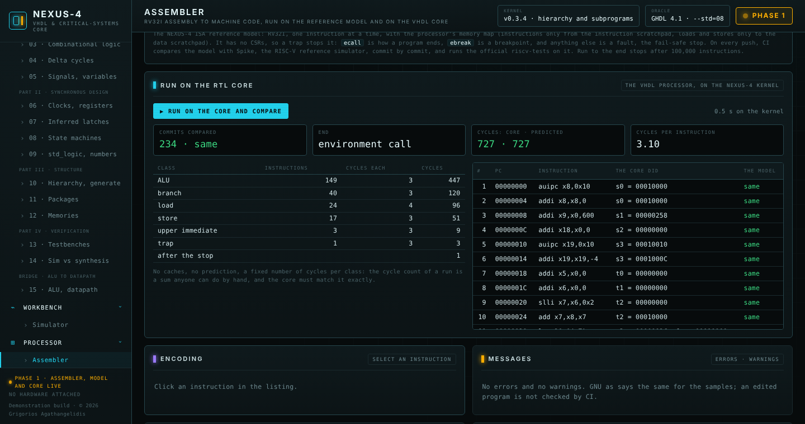
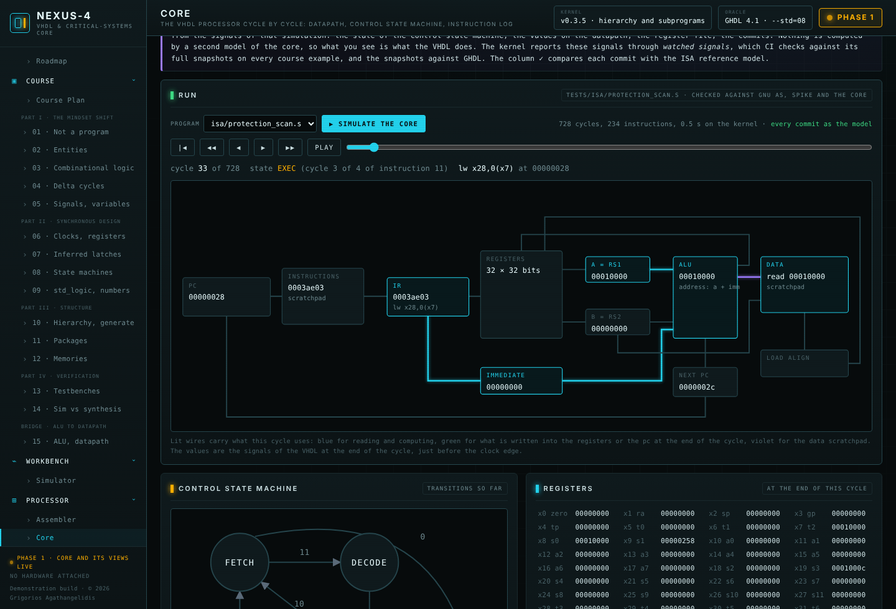
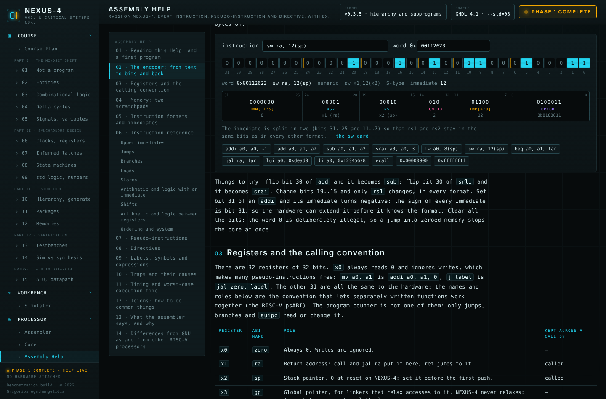
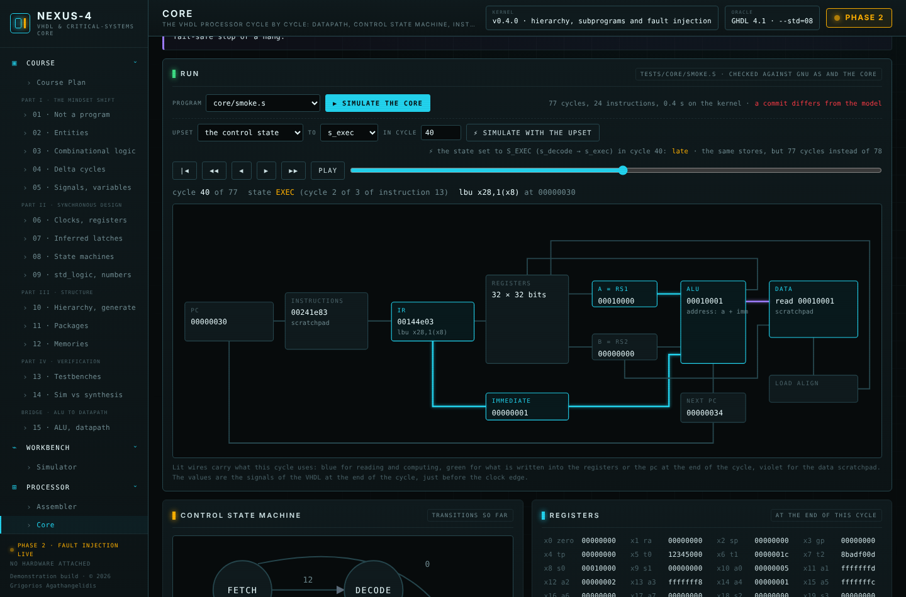
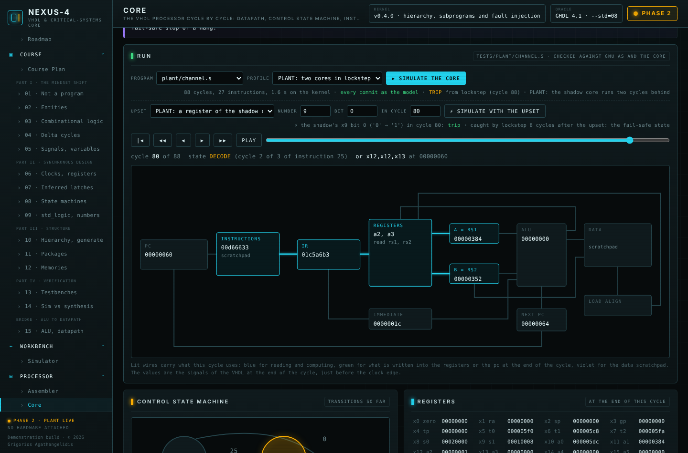
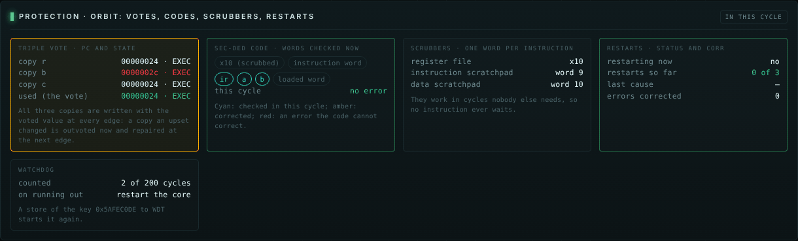
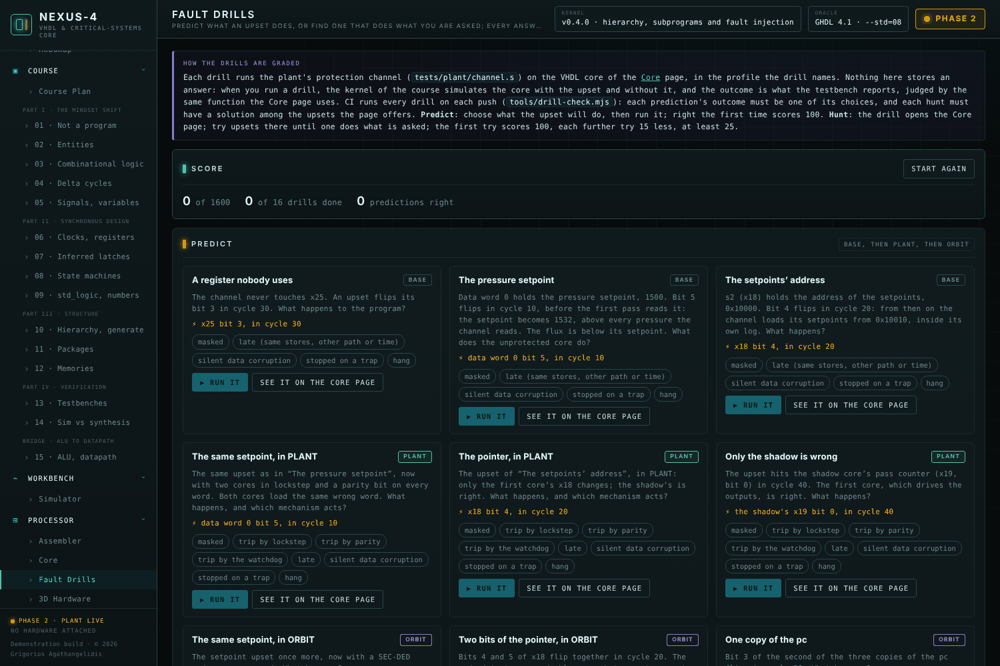
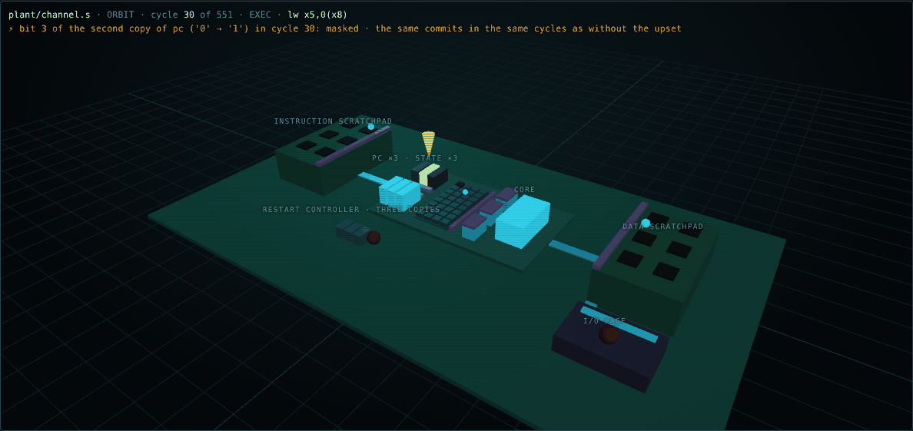
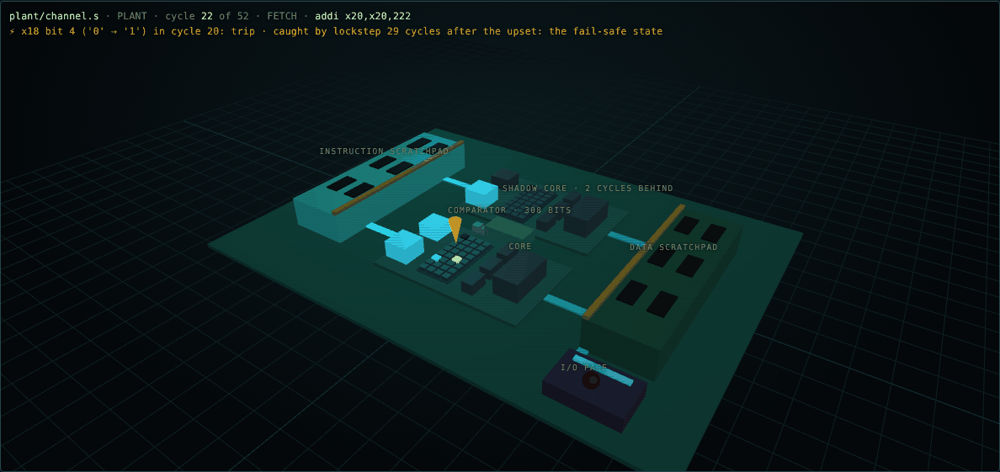
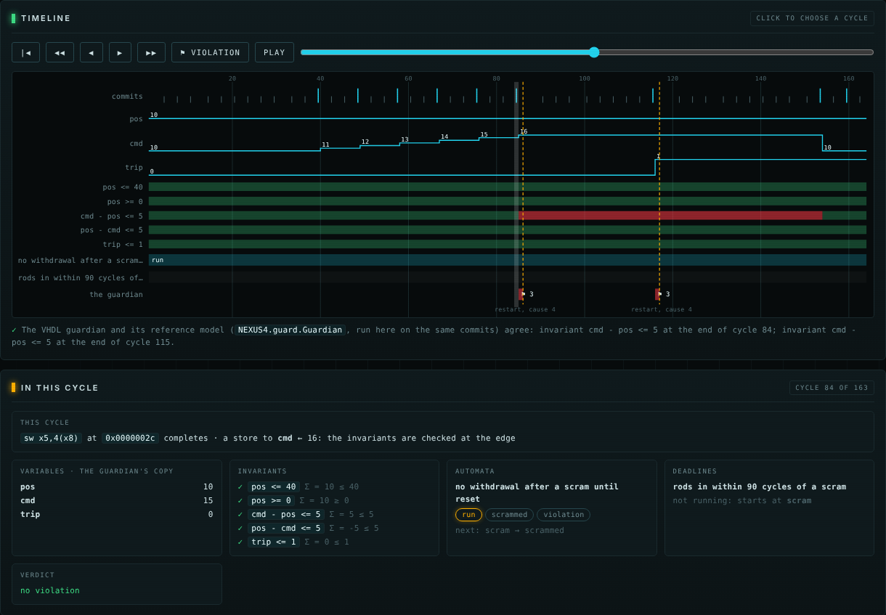

# NEXUS-4 — Critical-Systems Processor & VHDL Workbench

**A single-file VHDL course, a time-predictable RISC-V processor for critical systems, and a hardware guardian that checks formal properties while the processor runs.**

[](LICENSE)


[](https://github.com/gregory82gr/Nexus-4-phase-0/actions/workflows/differential.yml)

> **Status: Phases 0, 1 and 2 complete.** What exists today:
> - the console (`index.html`: overview, the course, simulator, assembler, core, fault drills, 3D hardware, assembly Help, verification, roadmap, About),
> - **the whole course, chapters 1–15**, live, with workbenches in the text and drills graded by the oracle (see [Chapters](#chapters)),
> - the **simulator workbench**, live: a VHDL editor, waveforms and a delta-cycle inspector running on the kernel in the browser (see [The simulator workbench](#the-simulator-workbench-live)),
> - the **simulator kernel v0.4** (hierarchy, packages and subprograms, and fault injection; see [Kernel status](#kernel-status)), which agrees with GHDL delta cycle by delta cycle on all 42 examples,
> - the GHDL oracle tooling, its examples, and mutation checks that prove the tests can fail,
> - the **RV32I assembler**, live, which produces exactly the bytes GNU `as` produces, with a disassembler that prints what `objdump` prints (see [The assembler](#the-assembler-live)),
> - the **ISA reference model**, live on the same page, which agrees with Spike, the RISC-V reference simulator, instruction by instruction and passes the official riscv-tests for RV32I (see [The ISA reference model](#the-isa-reference-model-live)),
> - the **RV32I processor core in VHDL**, multi-cycle, live on the same page on the kernel of the course, which agrees with the model on every instruction and with the predicted cycle count on every program (see [The RTL core](#the-rtl-core-live)),
> - the **Core page**, which shows that core cycle by cycle from its own signals: datapath, control state machine, registers and instruction log (see [The Core page](#the-core-page-the-processor-cycle-by-cycle-live)),
> - the **assembly Help**, a reference for writing NEXUS-4 programs by hand: all 40 instructions with their encodings, a visual encoder between text, hex and bits, pseudo-instructions, directives, expressions, traps, timing with a cycle counter, and 18 idioms, every example runnable and every one checked in CI (see [The assembly Help](#the-assembly-help-live)),
> - **fault injection** (Phase 2, first steps): single-event upsets in any state element of the running core, on the Core page, and a fault campaign on the unprotected core whose upsets in architectural state are checked against the ISA model (see [Fault injection](#fault-injection-phase-2-live)),
> - the **PLANT profile**: two cores in delayed lockstep, parity on the scratchpads, a watchdog and a trip output, with an I/O page for the plant's sensors; in a fault campaign on the plant's protection channel, every upset is either masked or ends in a trip (see [The PLANT profile](#the-plant-profile-live)),
> - the **ORBIT profile**: a SEC-DED code on the register file and both scratchpads with scrubbing, triple voting on the pc, the control state and the restart controller, and restarts the program can see; in its fault campaign every upset of what it protects is masked, in the cycles of the fault-free run (see [The ORBIT profile](#the-orbit-profile-live)),
> - the **console for the profiles**: a Protection panel on the Core page (PLANT's lockstep and parity, ORBIT's votes, codes, scrubbers and restarts, cycle by cycle), scored **Fault Drills** graded by running the VHDL, and the same run as **3D Hardware** (see [The console for Phase 2](#the-console-for-phase-2-live)),
> - the GitHub Actions workflow that runs all of it on every push.
>
> Phase 3, the hardware guardian, has started: its marker instruction `nx.mark` is in the assembler, the model and the core (see [The marker instruction](#the-marker-instruction-live)). Next: the guardian engine. This README also describes the design that has been decided; a feature exists only when the [roadmap](#roadmap) marks it as available.

NEXUS-4 will run entirely in the browser from one `index.html`, like its siblings. It has three parts that build on each other:

1. **A complete, interactive VHDL course.** It is written for software engineers who can program but have never designed hardware. It runs on its own VHDL simulator, written in JavaScript, which shows every delta cycle.
2. **A RISC-V processor at RTL level, for critical systems.** The core is RV32I, multi-cycle and in-order. It is written in VHDL and runs on the same simulator, next to a reference model of the instruction set that checks it on every instruction.
3. **A hardware guardian.** This is a small, hardwired unit derived from a formal specification. It watches the processor and steps in when a safety, bounded-liveness or idempotency property is violated, whether the cause is a design error or a radiation-induced bit flip.

NEXUS-4 is the fourth system in the NEXUS series:
- [NEXUS-1](https://github.com/gregory82gr/nexus1), the nuclear plant ([live demo](https://gregory82gr.github.io/Nexus-1-phase-0))
- [NEXUS-2](https://github.com/gregory82gr/Nexus-2-phase-0), the satellite constellation ([live demo](https://gregory82gr.github.io/Nexus-2-phase-0))
- [NEXUS-3](https://github.com/gregory82gr/Nexus-3-phase-0), the shared-memory multiprocessor ([live demo](https://gregory82gr.github.io/Nexus-3-phase-0))

It reuses their design language. Its processor is meant for the first two: the protection channel of the NEXUS-1 plant and the on-board computer of a NEXUS-2 satellite.

> **Simulation only.** NEXUS-4 is a demonstration and study tool. Its processor has not been synthesized for, or qualified on, any real device. It is not certified to any safety standard and must not be used to protect any real plant, vehicle or person. Standards are cited for orientation only (see [Standards awareness](#standards-awareness)).

---

## Why NEXUS-4

NEXUS-3 was about **hiding** time: out-of-order cores, caches, prefetching and latency tolerance. NEXUS-4 is about the opposite: making time **predictable**, and making a processor **checkable**.

In a critical system, being fast on average matters less than two other questions:
- Will this instruction sequence always finish within N cycles?
- Can we tell, while it runs, that the software still respects its specification?

NEXUS-4 is built around those two questions.

---

## Part 1 — The VHDL course (Phase 0)

### Approach

The course explains VHDL through ideas its readers already know:

| VHDL | Software analogy used in the course |
|---|---|
| Signal assignment | Recording an event: the change is scheduled, not applied |
| Delta cycle | A commit: all scheduled changes apply together and wake their handlers |
| Process | An event handler or projection that reacts to changes |
| Variable | Local state inside the handler, updated immediately |
| Finite state machine | The states of an aggregate |

### The simulator workbench (live)


The **Simulator** page runs the kernel in the browser. Pick one of the examples, or write your own design, and run it:
- **Editor.** Syntax highlighting and line numbers; `Ctrl+Enter` runs. A VHDL error, a run-time error or a construct the kernel does not support yet is reported with its line, and the line is marked.
- **Waveforms.** Two views of the same run. *Delta cycles* gives every simulation cycle its own column, so a zero-delay chain shows as a staircase at one point in time. *Time* is the usual waveform view, where the delta cycles of a time step collapse and only a small `×n` mark says they were there. Vectors are shown as buses (binary, hex or decimal; signed values in decimal) and expand into their scalar parts. The ports of instances, which are other names for signals already listed, are hidden unless *Ports* is on. A transaction that is not an event is marked with a dot, and a transaction GHDL leaves out (see [the calibrated exception](#continuous-integration-github-actions)) with a hollow dot.
- **Delta-cycle inspector.** For every cycle, the three phases of the simulation cycle: which drivers were updated (events, and transactions without events), which processes woke up and why, and what they did (the assignments they scheduled, with the time each value is due, and their messages). A short note explains the cycle in software terms.

The examples in the workbench are copies of `tests/examples/*.vhd`, embedded in `index.html` by `tools/embed-examples.mjs`, and CI fails if the copies differ from the files. So an unedited example in the workbench is exactly the file that CI has compared with GHDL; the page says so, and says "edited · not verified" as soon as you change it. A run stops after 5,000 cycles.

### Chapters


| Chapter | Status | What it uses |
|---|---|---|
| 1. Hardware is not a program | **live** | `trip_voter` (the 2-out-of-3 trip vote of a protection channel), `resolution_conflict`; a 5-question drill |
| 2. Entity and architecture | **live** | `two_architectures` (one entity, two implementations checked against each other), `port_initial_value`; a 5-question drill |
| 3. Combinational logic | **live** | `combinational`, `alarm_priority` (when/else versus with/select), `missing_sensitivity`; a 6-question drill |
| 4. The simulation kernel and delta cycles | **live** | `delta_chain`, `delta_glitch`, `swap_signals`; a 6-question drill |
| 5. Signals versus variables | **live** | `signal_vs_variable`, `last_assignment_wins`, `variable_persists`; a 6-question drill |
| 6. Clocks, flip-flops and reset | **live** | `unreset_register`, `clocked_counter`, `reset_styles`, `register_inference`, `edge_detection`; a 6-question drill |
| 7. Inferred latches | **live** | `inferred_latch` (latch, default assignment, clock enable); a 5-question drill |
| 8. State machines | **live** | `protection_fsm`, `fsm_safe_recovery` (an upset into an unused state code, recovered by `when others`); a 6-question drill |
| 9. std_logic and numeric_std | **live** | `wired_bus` (pull-up, open drain, weak conflict, `to_x01`), `numeric_std_traps`; a 6-question drill |
| 10. Hierarchy, generics and generate | **live** | `ripple_adder` (a generic adder by for-generate; the carry ripples one delta per stage), `hierarchy_ports`, `fault_profiles` (PLANT lockstep and ORBIT TMR by generic); a 6-question drill |
| 11. Packages, functions and procedures | **live** | `plant_package` (a reading record and fail-safe rules: an invalid sensor votes for the trip), `packages_subprograms`; a 6-question drill |
| 12. Memories and register files | **live** | `register_file`, `ram_read_timing` (asynchronous and synchronous reads, read during write), `aggregates_slices`; a 6-question drill |
| 13. Self-checking testbenches | **live** | `tb_self_check` (a table of cases, a check procedure, a summary), `assert_failure`, `wait_forms`; a 6-question drill |
| 14. Simulation versus synthesis | **live** | `timing_is_not_logic` (`after 30 ns` versus counting edges), `inertial_vs_transport`; a 6-question drill |
| 15. The ALU and the datapath | **live** | `alu_rv32` (the ten RV32I ALU operations, twelve test vectors), `datapath_step` (register file, ALU and PC, one instruction per clock); a 6-question drill |

A chapter is text plus live workbenches on examples from `tests/examples`, so every example a reader runs is one that CI compares with GHDL. The drill at the end of a chapter does not store its answers: each answer is computed from a run of its example, and `tools/course-check.mjs` checks in CI that every computed answer is one of the options and that every cycle the text points at exists. So the drills are graded by the oracle too.

Chapters 1–3 introduce the mindset with the plant's own logic: the 2-out-of-3 trip vote as an always-on circuit, one entity with two diverse implementations checked against each other, and an alarm annunciator that shows priority versus tables. Chapter 4 is the centre the rest of the course leans on: the simulation cycle (update, resume, execute), delta cycles that take no time, a delta glitch that a waveform viewer hides and the simulator does not, two processes that swap values without a temporary, and the difference between a transaction and an event. Chapter 5 builds on it: a variable changes at once and a signal in the next update, so `s <= s + 1` in a loop adds 1, the last assignment wins, and a process variable keeps its value between activations while a function's starts fresh.

### Planned structure

- **Part I, the mindset shift:**
  - hardware is not a program
  - entity and architecture as interface and implementation
  - combinational logic
  - the simulation kernel and delta cycles
  - signals versus variables
- **Part II, synchronous design:**
  - clocks, flip-flops and reset
  - inferred latches
  - state machines
  - the nine values of `std_logic` and `numeric_std`
- **Part III, structure:**
  - hierarchy, generics and `generate`
  - packages
  - memories and register files
- **Part IV, verification:**
  - self-checking testbenches
  - what becomes hardware and what exists only in simulation
- **Bridge:** from an ALU to a datapath, leading into Part 2.

Every chapter includes:
- live workbenches: editor, waveform viewer and delta-cycle inspector
- a "for the software engineer" box
- a "trap" box
- a scored drill, in the style of the Training Mode of NEXUS-2 and NEXUS-3, graded from verified runs

### The language subset

The simulator implements **VHDL-93 plus selected VHDL-2008 features**: `process(all)`, reading output ports, conditional assignment inside processes, reduction operators and `to_string`.

One rule decides what is in: a feature is supported if the processor or its testbench needs it, or if it is needed to teach a semantic trap. Examples:
- `std_logic` resolution is in, because a tri-state bus is too good a lesson to skip.
- Access types, file I/O and `textio`, configurations, protected types and generic packages are out.

Examples that need features outside the subset are shown as pre-computed GHDL runs, clearly marked as such.

---

## Part 2 — The processor (Phases 1 and 2)

### The assembler (live)


The **Assembler** page turns RV32I assembly into machine code as you type. The listing shows each address, machine word and source line, and the instruction as the NEXUS-4 disassembler reads it back; click an instruction and its bit fields are drawn, format by format. This is the first piece of the visual encoder of the assembly Help.

- **What it accepts.** All 40 instructions of the RV32I base (the 37 computational, load, store and control-transfer instructions, plus `fence`, `ecall` and `ebreak`; the CSR instructions belong to the Zicsr extension and are not part of the core), and the pseudo-instructions of the GNU assembler (`li`, `la`, `mv`, `not`, `neg`, `seqz`, `bgt`, `ble`, `j`, `call`, `tail`, `ret`, loads and stores to a symbol, and the rest), expanded the way GNU expands them. Directives: `.text`, `.data`, `.section`, `.globl`, `.equ` / `.set` / `=`, `.align` / `.p2align` / `.balign`, `.byte` / `.half` / `.word`, `.zero` / `.space`, `.ascii` / `.asciz` / `.string`, `.rept` / `.endr`. Expressions are evaluated in 64 bits, as GNU evaluates them, with `%hi`, `%lo`, `%pcrel_hi`, `%pcrel_lo`, and numeric local labels (`1b`, `1f`); several statements may share a line, separated by `;`.
- **Memory map.** Code starts at `0x00000000` and data at `0x00010000`, as the scratchpads of the processor will.
- **The oracle.** `tools/asm-check.mjs` assembles every program in `tests/asm` with both assemblers and links GNU's output with a two-line linker script for the same map. The `.text` and `.data` bytes must be identical, and so must every symbol address. Every line of `tests/asm/errors.txt` must be rejected by both. Then three random programs of 3,000 lines each and three sets of random constant expressions (fixed seeds) are compared the same way, and every instruction in the programs is disassembled by both NEXUS-4 and `objdump -M no-aliases,numeric`, which must print the same text. The official riscv-tests are a fourth corpus: all 40 rv32ui tests that NEXUS-4 runs assemble to identical bytes (see [The ISA reference model](#the-isa-reference-model-live)).
- **Where it is stricter than GNU, on purpose.** NEXUS-4 rejects an instruction at an address that is not a multiple of 4, padding in `.text` that is not whole instructions, a fill value for alignment in `.text`, a branch out of range, a division by zero in an expression, and a shift count outside 0…63. GNU accepts all six: the branch it rewrites silently into the opposite branch over a `jal`, so the code grows by an instruction nobody wrote, and the division and the shift it replaces with a value of its own after a warning. `tests/asm/stricter.txt` lists them, and CI checks that GNU still accepts each one and NEXUS-4 still rejects it. Whatever both accept is byte-identical.
- **Mutation checks.** `tools/asm-mutations.mjs` breaks the assembler in 26 ways (rounding of the upper immediate, scattered B and J immediate bits, S-type halves, `srai`, the expansions of `li`, `ble`, `sgtz` and `call`, range checks, `x0` as a target of `la`, `.balign`, 32-bit instead of 64-bit expressions, the RV32 normalization of constants, the end of `.data`, `.rept`, `jr rs, imm`, C's operator precedence, a label accepted as an immediate, label differences refused in `.equ`, an unchecked shift count, and two disassembler decodings), and the comparison must fail on each. Its first run found two gaps: no test branched more than 2 KiB forward, and the `la x0` error case failed for the wrong reason; `tests/asm/long_branches.s` and a corrected error case close them.

The comparison found five differences while the assembler was written, all now followed: GNU accepts an immediate in place of the second source register of `add`, `and`, `or`, `xor`, `slt`, `sltu`, `sll`, `srl` and `sra` (but not `sub`) and assembles the I-type instruction; it rejects `la`, `lla` and loads from a symbol with `x0` as the target; it keeps the `addi` of `li x0, 0x12345000` that it leaves out for every other register; it accepts an empty `.byte`; and it rejects `.align` with more than three arguments.

The riscv-tests sources and the random expressions found five more. GNU on a 64-bit host evaluates expressions in 64 bits: a constant whose upper 32 bits are all 0 or all 1 is the sign extension of its low 32 bits, so `li a0, 0xfffffff0` is one `addi`, while any other constant keeps all 64 bits, so `li a0, 0x100000000` is `lui a0, 0`. It pads the end of `.text` to its alignment but not the end of `.data`. It accepts `jr rs, imm`, `jalr rs, imm` (linking through `ra`), `call rd, symbol` (through `t1`) and `jump symbol, rt`. And it has `.rept`.

Writing the assembly Help found three more, because explaining a rule meant checking it. GNU's operator precedence is not C's: it has three levels, with `&`, `|` and `^` binding tighter than `+` and `-`, so `1 << 2 + 3` is 7 (NEXUS-4 had C's, and gave 32; the random expressions had always been fully parenthesized, so they never saw it, and now half of them are not). GNU refuses a label as an instruction immediate (`addi a0, a0, sym` needs `%lo`), which NEXUS-4 accepted. And GNU accepts the difference of two labels of one section in `.equ` (`.equ LEN, end - start`), which NEXUS-4 refused. All three now follow GNU, with corpus lines, error cases and mutations.

### The ISA reference model (live)


The reference model is the specification the processor core will be held to: RV32I, one instruction at a time, in about 250 lines of JavaScript in `<script id="nexus4-isa">`. On the **Assembler** page, *Step*, *Run 100* and *Run to the end* run the assembled program on it. The registers it changed light up, every committed instruction is logged with the register it wrote and the memory it touched, and the `.data` panel shows the data scratchpad as the program left it.

- **The machine it describes.** Two scratchpads, as in the processor (Harvard): instructions are fetched only from the instruction scratchpad at `0x00000000`, loads and stores reach only the data scratchpad at `0x00010000`, 64 KiB each. There are no CSRs and no privilege modes, so a trap stops the machine, with the cause numbered as in `mcause`. `ecall` is how a program ends, `ebreak` is a breakpoint, and anything else (an illegal instruction, a misaligned access or jump target, an address outside the scratchpads) is a fault: the core stops, which for a protection channel is the fail-safe reaction.
- **Checked against Spike.** `tools/isa-check.mjs` assembles and links each program with GNU where Spike, the RISC-V reference simulator, expects memory (`0x80000000` and `0x80010000`), runs it on Spike with a commit log, and runs the same bytes on the model. Every committed instruction must match: pc, instruction word, the register written and its value, the memory address and the value stored. The programs are `tests/isa/*.s` and three random programs of about 7,000 executed instructions each (straight code, forward branches and jumps, `jalr` through `auipc`, short counted loops, loads and stores of every width). Spike is built from source at a pinned commit and cached in CI.
- **Traps.** Every case in `tests/isa/traps.txt` (38 of them: illegal encodings, misaligned loads, stores and jump targets, access faults, `ecall`, `ebreak`) must stop Spike and the model at the same instruction, with the same cause and the same `tval`.
- **Where it is stricter than Spike, on purpose** (`tests/isa/differences.txt`): `fence.i`, the CSR instructions, `wfi` and `mret` are illegal, because the core implements RV32I and nothing else; and loads or stores to the instruction scratchpad, or a jump into the data scratchpad, are access faults, because the scratchpads are separate. Spike, with one memory and the usual extensions, runs them all. CI checks that it still does and that the model still stops at the right instruction with the right cause. The reverse, NEXUS-4's own marker instruction, which Spike stops on, is in `tests/isa/extensions.txt` (D58).
- **The official riscv-tests.** `tools/riscv-tests.mjs` takes the rv32ui tests from [riscv-tests](https://github.com/riscv-software-src/riscv-tests) (fetched at a pinned commit, not copied here), expands them with the C preprocessor and a NEXUS-4 environment (`tests/riscv-tests/riscv_test.h`: no CSRs, the test ends with `ecall`), assembles each with the NEXUS-4 assembler and with GNU (the bytes must be identical) and runs it on the model. All 40 pass. Two are left out with their reasons: `fence_i` (Zifencei is not in the core) and `ma_data` (misaligned accesses trap on the core, and the test needs them to work or a trap handler).
- **Mutation checks.** `tools/isa-mutations.mjs` breaks the model in 25 ways (arithmetic and comparisons, signed and unsigned branches, `jal`/`jalr` links and targets, `auipc`, writes to `x0`, sign and zero extension of loads, store widths, byte order, the order of the alignment and access checks, the Harvard rule, decoding of `fence.i` and of shift encodings, `tval`, trap causes). Spike or the riscv-tests must catch each one. The first run found two gaps: a shift with an illegal `funct7` was accepted, and a `fence.i` that ran on was still reported as the expected stop, because the check did not look at where the model stopped. Both are closed.


### Core

| Aspect | Choice | Why |
|---|---|---|
| Instruction set | RISC-V RV32I, plus one marker instruction for the guardian | Small, open and formally specified. Its reserved custom opcode space holds the guardian's marker (`nx.mark`, custom-0) |
| Microarchitecture | Multi-cycle, in-order | Each instruction class takes a fixed number of cycles, so worst-case execution time is a sum. The guardian sees one completed instruction at a time, with exceptions that point at an exact instruction |
| Memory | Scratchpad, no caches | No hit-or-miss timing to bound |
| Branches | No dynamic prediction | Same reason |
| Programs | Hand-written assembly | Through the NEXUS-4 assembler, with an extended assembly Help and a visual instruction encoder |

The reference model of the instruction set ([live](#the-isa-reference-model-live)) runs in the browser next to the RTL core. The two are compared after every instruction, so the reader can watch the implementation keep to its specification.

### The RTL core (live)



The processor is in `rtl/`: `nexus4_pkg.vhd` (types, the memory map, trap causes), `nexus4_core.vhd` (the core and the two scratchpads) and `nexus4_soc.vhd` (the core with its scratchpads, loaded with a program from the package `nexus4_program`). It is written in the VHDL subset of the course, so the page simulates it with the same kernel the chapters use.

- **Four states.** FETCH (the instruction scratchpad reads the word at `pc`), DECODE (the word arrives in `ir`; `rs1` and `rs2` are read), EXEC (the ALU, the branch comparison and the address adder; everything but a load completes here) and, for loads only, MEM. So **every instruction takes 3 cycles and a load takes 4**, whatever its data: a taken branch costs the same as one not taken. The decoding and the ALU are one combinational process; the state machine, the register file and the commit port are one clocked process.
- **Traps stop the core.** The same rule as the model: an illegal instruction, `ecall`, `ebreak`, a misaligned or out-of-range access or jump target sends the core to HALT, with the cause numbered as in `mcause`.
- **The commit port.** For one cycle after each instruction completes or traps, the core reports what it did: pc, instruction, the register written and its value, the memory address and the value stored, or the trap with its cause and `tval`. This is how it is compared with the model, and later how the guardian will watch it.
- **The comparison.** `tools/core-check.mjs` assembles each program, writes it into `nexus4_program`, runs the testbench `tests/core/tb_nexus4.vhd` on GHDL and compares every commit with the model, given the same scratchpad sizes. Then it compares the cycle count with the sum the instruction classes predict: no caches and no prediction mean the two must be equal, not close. The programs are the samples (`tests/core`, `tests/isa`), the 38 trap cases and 8 deliberate differences of the model, the 62 programs of the assembly Help, three random programs of about 7,000 instructions, and the 40 riscv-tests rv32ui. `tests/core/boundaries.s` reads and writes the last word, half-word and byte of the data scratchpad and runs an instruction from the last word of the instruction scratchpad.
- **On the NEXUS-4 kernel too.** The samples also run on the kernel of the course and must give the same commits and cycles, and `tests/core/smoke.s`, which touches every class of instruction, is compared with GHDL delta cycle by delta cycle, every signal of the core, the same comparison as the course examples (D29).
- **Mutation checks.** `tools/core-mutations.mjs` breaks the core in 27 ways (ALU operations, immediates, branch comparisons, `jal`/`jalr` links and targets, `x0`, load extension and lanes, store lanes and byte enables, trap causes and their order, the edges of both scratchpads, illegal encodings, and one change that leaves every result the same but costs a cycle at odd word addresses, which only the cycle count can catch). Every one is caught. Two survived the first run: one was equivalent to the correct core and was replaced, and one showed that nothing touched the last word of the data scratchpad, which `boundaries.s` now does.
- **On the page.** The Assembler page has *Run on the core and compare*: the core runs the program in the browser (up to 6,000 cycles), and the page shows the commits next to the model's, the cycles measured against the cycles predicted, and the cycles per instruction class.
- **Found on the way.** The kernel folded an aggregate with `others` before a function's local array knew its bounds (the scratchpads build their images that way); fixed in kernel 0.3.4 and pinned by `tests/examples/local_bounds_aggregate.vhd` and a kernel mutation.

### The Core page: the processor cycle by cycle (live)



**Processor → Core** runs a program on the VHDL core in the page and shows it one clock cycle at a time: the datapath with the wires the cycle uses lit and the values on them, the control state machine with the state of this cycle, the transition it takes at the next edge and how often each transition has been taken, the register file with the registers that just changed, and the instruction log with each instruction's cycles, what it did and a ✓ where the model agrees. Step by cycle or by instruction, drag the slider, play, or click an instruction to go to its first cycle.

Everything on the page comes from the signals of the VHDL simulation, never from a second model of the core (D46): what the page shows is what the core does. To make that affordable, kernel 0.3.5 can *watch* signals: it reports a chosen signal whole each time one of its bits changes, instead of every bit after every delta cycle. The differential test checks this on every course example: run again with every signal watched, the watched values must reproduce every snapshot, and the snapshots are what is compared with GHDL. Two kernel mutations (a vector reported right to left, a signal reported only for its first bit) make sure that check can fail. The protection scan (728 cycles) takes about half a second in the browser; the page stops at 6,000 cycles.

The hardware has 64 KiB in each scratchpad. A simulation gives the core the smallest power of two (at least 16 words) that holds the program, and the model is given the same sizes, so the edges of memory are compared too.

### The assembly Help (live)



**Processor → Assembly Help** is the reference for writing NEXUS-4 programs by hand, in fourteen chapters with a table of contents and a filter:

1. reading the Help, and a first program;
2. **the visual encoder**: type an instruction, or a word in hex, or click any of the 32 bits, and the other two follow, with the fields drawn by role, the immediate decoded and a link to the instruction's card;
3. registers and the calling convention, and how to set up a stack when every register is 0 at reset;
4. memory: the two scratchpads, the Harvard rules, alignment and byte order, and what each broken rule does;
5. the six formats and their immediates, each drawn from a real word;
6. **the instruction reference**: a card for each of the 40 instructions with its syntax, operation, description, encoding, notes, traps and cycles, and an example;
7. pseudo-instructions, with their expansions computed by the assembler on the page;
8. directives;
9. labels, symbols and expressions, with GNU's precedence and a calculator;
10. traps and their causes, and which instructions raise each;
11. timing and worst-case execution time, with a counter that runs a program and gives, line by line, how often it ran and what it cost;
12. 18 idioms: constants, variables, loops, arrays, calls, a stack, multiplication and division without M, branch-free code, 64-bit addition, overflow, bit fields, a jump table, copying, counting bits, strings, a 2-out-of-3 vote and a counted delay;
13. what the assembler says about the commonest mistakes, and why;
14. the deliberate differences from GNU as and from Spike.

Every example, idiom and chapter program has *Run on the model*, which runs it on the reference model and shows whether it ended as the Help says, with its cycles on the core, and *Open in the Assembler*, which loads it into the Assembler page to step through it or run it on the VHDL core.

Nothing in the Help is a number to take on trust. `tools/help-check.mjs` checks in CI that the reference lists exactly the 40 instructions of RV32I; that each card's format, opcode, `funct3` and `funct7` are what the assembler produces and the disassembler reads back; that each card's cycles are the core's; that all 62 programs end on the model with the stated cause and register values; that every pseudo-instruction and directive example assembles; that every message example gets the error or warning the Help says; that the trap causes are the model's; and that the lists of differences are the test files that prove them. `tools/core-check.mjs` runs the same 62 programs on the VHDL core, which must commit as the model does in the predicted cycles. The assembler and the model are themselves checked against GNU binutils and Spike, so the chain ends at the reference tools.

### Two fault-tolerance profiles (Phase 2)

The same VHDL design builds two profiles through generics and `generate`:

| | PLANT (NEXUS-1) | ORBIT (NEXUS-2) |
|---|---|---|
| Main threat | Systematic faults: design errors and common-cause failures | Random faults: single-event upsets and accumulated radiation dose |
| Mechanisms | Lockstep with comparator, parity, watchdog, guardian mandatory | SEC-DED ECC on register file and memory with scrubbing, TMR on the program counter and control FSM, watchdog |
| On a detected fault | **Fail-safe**: trip | **Fail-operational**: correct it, or restart; the program sees the restart and can go to safe mode |

The reader can flip any bit of the running processor and watch which mechanism catches it, or see that nothing does.

Decided for Phase 2 (D52): PLANT first, with two cores in **delayed lockstep, two cycles apart** (as the CCM-R5 of TI's Cortex-R5 parts and Infineon's AURIX do, against common-cause transients such as a clock or supply glitch), a comparator on the commit port and the memory bus, a watchdog and a trip output; then ORBIT, with a Hsiao (39,32) SEC-DED code on the register file and both scratchpads, scrubbing only in the cycles where the data scratchpad is idle (FETCH and DECODE), so that **every instruction keeps its 3 or 4 cycles and the WCET does not change**, TMR with voting on the pc and the control state, and a restart into safe mode on an uncorrectable error. Programs reach the watchdog, the trip output, the status and the sensor inputs through an I/O page at `0x00020000`. Lockstep catches random hardware faults, not design errors: two identical cores make the same mistake together. Against those, the plant has diverse channels, and NEXUS-4 will have the guardian (Phase 3).

### Fault injection (Phase 2, live)



**Kernel 0.4** can upset the state of a running design: `simulate({ ..., faults: [{ signal, at, kind }] })`, where `signal` names one bit or element (`…regs(5)(3)`, `…state`), `kind: 'flip'` inverts it and `kind: 'set'` gives it a value of its type. The fault is a **deposit** into the driver, the semantics of `force -deposit` in commercial simulators: the bit stays upset until its element is written again, as a flip-flop does after a single-event upset. VHDL has no statement for this. `force`/`release` changes the effective value and gives it back at release, so a register that holds its value would forget the upset; GHDL 4.1's VPI was tried too, and its deposit turned out to be a permanent force whose release has no effect. So the deposit is checked in two other ways:

- **Against GHDL, with saboteurs** (`tools/fault-check.mjs`): each example in `tests/faults` contains, compiled in only with the generic `SAB = true`, code that makes the process owning each upset element write the upset value itself at the fault's time. GHDL runs the saboteurs; the kernel runs the plain design with its `-- @fault:` lines. A saboteur's write lands one delta cycle after the deposit, so the comparison is at the end of every time step: the same time steps, the same value on every signal. Two controls make sure it can fail: without its faults, and with any one fault a nanosecond late, the kernel must differ from GHDL. `seu_basics.vhd` upsets a held register, an element of a register file, a ROM nobody drives, an enumerated state and an integer counter.
- **Against the ISA model, on the processor** (`tools/fault-campaign.mjs`): an upset in architectural state (the register file, the data or the instruction scratchpad) has an exact meaning at the level of the instruction set: the same bit flipped between two instructions, at the point the core's fixed timing gives. The core reads `rs1` and `rs2` at the end of DECODE, writes `rd` at the end of EXEC (MEM for a load), reaches the data scratchpad at the end of EXEC and fetches at the end of FETCH; an upset of `rd` during the instruction that writes it is overwritten. For every such upset in the campaign, the core's commits and cycles must be exactly those of the model with the same flip. Random upsets rarely hit what is in use at that moment, so the campaign adds upsets aimed at the operands, results, memory words and instruction words of instructions, in each of their cycles. Three wrong versions of the timing rule were tried by hand, and each made several of these checks fail.

Three kernel mutations (a deposit into the effective value instead of the driver, an integer flip of the wrong bit, a `set` that ignores its value) are caught by `fault-check`. The instruction scratchpad became a signal that no process drives instead of a constant, so that its bits can be upset; nothing else in the core changed.

**The unprotected core, under upsets.** `tools/fault-campaign.mjs` runs the protection scan of the plant (`tests/isa/protection_scan.s`, 727 cycles) once without faults and then once per upset, one bit at a random cycle, and classifies each run against the fault-free one: *masked* (the same commits and cycles), *late* (the same stores but a different path or time: harmless for the results, not for a deadline), *SDC* (silent data corruption: a normal end with different stores), *DUE* (the core stops on a trap other than `ecall`, which is the fail-safe stop) or *hang* (no stop within twice the cycles). With 80 upsets per structure (`NEXUS4_PER=80`, seed 4004):

| Structure | Bits | Masked | Late | SDC | DUE | Hang |
|---|---:|---:|---:|---:|---:|---:|
| Register file (x1–x31) | 992 | 66 | 1 | 4 | 9 | 0 |
| Data scratchpad | 512 | 65 | 0 | 15 | 0 | 0 |
| Instruction scratchpad | 2,048 | 38 | 6 | 14 | 21 | 1 |
| pc | 32 | 0 | 1 | 4 | 75 | 0 |
| ir | 32 | 50 | 11 | 13 | 6 | 0 |
| a and b | 64 | 66 | 3 | 6 | 5 | 0 |
| Control state | 3 | 0 | 24 | 20 | 36 | 0 |
| Load registers | 37 | 79 | 1 | 0 | 0 | 0 |
| Scratchpad read registers | 64 | 63 | 8 | 6 | 3 | 0 |

The samples are per structure, not per bit, so the totals are not a vulnerability factor of the whole core; with 80 samples a count is good to roughly ±10. What the table shows is enough for the next step: an unprotected core turns about one upset in nine into silent data corruption, and in a protection channel a silent wrong value is a missed trip. Upsets of the pc mostly stop the core (it lands outside the program or on a misaligned target), which is the safe outcome; upsets of the data and the instructions mostly do not. CI runs the campaign with 24 per structure on every push; it fails if the core and the model with the same upset ever disagree (122 such checks, 0 disagreements), not on the outcome counts, which describe the unprotected core rather than check it.

**On the Core page**, *Upset* picks a register, a data or instruction word, the pc, ir, a, b or the control state, a bit and a cycle; *Simulate with the upset* runs the core with it and says what it did, and the instruction log marks where it happened (⚡) and where the commits leave the model's (✗).

### The PLANT profile (live)



PLANT is the profile for the protection channel of the NEXUS-1 plant: **fail-safe**, so any fault it detects must end in a trip, and a trip, once made, must stay. The VHDL is one design; the program package's `PROGRAM_PROFILE` selects the profile (D16), and `rtl/nexus4_soc.vhd` builds PLANT with an `if … generate`.

- **The I/O page** (all profiles, `0x00020000`, eight word registers): four sensor inputs; TRIP, whose bit 0 a program sets to trip and which reads back the causes of the trip (the program, lockstep, parity, the watchdog); WDT, which restarts the watchdog only when written with the key `0x5AFEC0DE`, so that a runaway store is very unlikely to keep it quiet; STATUS, the profile (and in ORBIT the restarts and their cause); CORR, the errors ORBIT has corrected. Only `lw` and `sw` reach it: anything narrower stops the core with an access fault. An `lw` from it takes the same 4 cycles as one from RAM. The ISA model has the same page, and every program is compared with the core through it; Spike, which has no such page, is not asked about it.
- **Delayed lockstep.** A second core, the *shadow*, runs the same program two cycles behind the first, fed with the first core's inputs two cycles late (the scheme of TI's CCM-R5 and Infineon's AURIX, which spaces the two cores in time so that one disturbance, a glitch of the clock or the supply, does not hit both at the same point of the program). Every output of the first core, two cycles late, is compared with the shadow's: the instruction and data addresses, the data written and its byte lanes, the commit port. A difference trips. The choice between RAM and the I/O page for a load is made once for each core, so that an upset in one choice shows as a difference.
- **Parity on what lockstep cannot see.** The scratchpads are outside the two cores: an upset there would reach both alike. Each word has a parity bit, checked when an instruction is fetched, when a word is loaded, and before a partial store merges new bytes into a word; the I/O page's read register has one too.
- **The watchdog** trips when it is not restarted for `PROGRAM_WDT_CYCLES` cycles: a program that hangs, or a core that stops on a trap, trips the plant.
- **The trip** stops both cores and stays until reset. Its latch is kept in three copies and the output is their OR, so an upset of one copy can make a trip but never clear one.
- **Timing.** The instructions keep their 3 and 4 cycles: the shadow's lag only adds two cycles at the end, before the system reports itself halted.

**What it does not catch.** Lockstep compares two identical cores, so a design error in the core, or in the program, is made by both and passes. That is a systematic fault, the plant's main threat (D15), and the answers to it are the diversity between the plant's channels and the guardian of Phase 3, not lockstep.

**Checked.** `tools/core-check.mjs` runs every sample program in PLANT as well, on GHDL and on the kernel: the same commits as the model, two more cycles, no trip of its own; a program that stops on a trap must be followed by a watchdog trip. `tests/plant/io_smoke.s`, which touches every register of the I/O page, runs the whole PLANT system on the NEXUS-4 kernel and on GHDL, compared delta cycle by delta cycle on every signal of both cores, the lockstep and the I/O page (298 delta cycles, about 10,000 signals). `tools/fault-campaign.mjs --plant` upsets the PLANT system running `tests/plant/channel.s`, a protection channel that votes two out of three pressure transmitters and checks the flux, and must trip with the sensor values it is given; on the unprotected core, the same program with the same sensors loses that trip in 9 of 360 upsets. With 40 upsets per structure (`NEXUS4_PER=40`, seed 4004):

| Structure | Bits | Masked | Trip |
|---|---:|---:|---:|
| First core: register file | 992 | 24 | 16 |
| First core: pc, ir, a, b, load registers | 165 | 13 | 27 |
| First core: control state | 3 | 0 | 40 |
| First core: commit port | 200 | 0 | 40 |
| Shadow: register file | 992 | 31 | 9 |
| Shadow: pc, ir, a, b, load registers | 165 | 12 | 28 |
| Shadow: control state | 3 | 0 | 40 |
| Shadow: commit port | 200 | 0 | 40 |
| Instruction scratchpad and parity | 2,112 | 26 | 14 |
| Data scratchpad and parity | 1,056 | 34 | 6 |
| Read registers | 99 | 26 | 14 |
| Lockstep delay lines and flags | 1,431 | 10 | 30 |
| I/O page: trip latches, watchdog | 20 | 24 | 16 |

No silent data corruption, no lost trip, no hang in 520 upsets: lockstep caught 273, parity 40, the watchdog 7, half of them within 2 cycles of the upset and all within 80. Zero in 520 is not a proof of zero: it bounds the rate of undetected upsets in this sample below about 0.6 % (95 %). Many trips are for upsets that would have done no harm (in the commit port, in the delay lines): that is the price of fail-safe, paid in availability, which a protection channel accepts. Eight aimed upsets with a known answer make sure each mechanism catches what it exists for (lockstep, the parity of a data word, an instruction word and the I/O read, the RAM-or-I/O choice, a trip latch copy). CI runs the campaign with 24 per structure and fails on any upset that is neither masked nor tripped. Nine more core mutations switch off a PLANT mechanism or break the I/O page (the comparator, each parity check, the triple trip latch, the shadow's lag, the watchdog and its key, word-only I/O); every one is caught, the ones that change nothing without faults by the campaign's aimed upsets. Three survived their first run, and each showed a gap: no test wrote a wrong value to the watchdog (now `tests/plant/wdt_key.s`, whose watchdog must trip exactly 60 cycles after the key), none made a byte access to the I/O page (two trap cases, which Spike, with nothing at that address, faults on too), and the trip-latch check looked only at the end of the run, when the channel had tripped again (now the trip must never drop).

On the Core page, *Profile: PLANT* runs both cores; the upsets can then also hit a register of the shadow or an instruction word's parity bit, and the result says which mechanism tripped and how many cycles after the upset.

### The ORBIT profile (live)

ORBIT is the profile for the on-board computer of a NEXUS-2 satellite: **fail-operational**. A satellite cannot be stopped and inspected, and most upsets in orbit are single bits, so ORBIT corrects what it can, where it is used, and restarts the core when it cannot; the program learns that it was restarted and why, and decides what to do (go to safe mode, say). The same VHDL as BASE and PLANT, with `PROGRAM_PROFILE = 2`: the core's generic `ORBIT` and an `if … generate` in `rtl/nexus4_soc.vhd`.

- **A SEC-DED code.** Every word of the register file, of both scratchpads, and of `ir`, `a` and `b` has 7 check bits beside it: a Hsiao (39,32) code (single error correction, double error detection), whose 32 columns all have three ones and whose rows are balanced (13 or 14 ones), so each check bit is a small XOR tree. A word is checked and corrected **where it is used**: the instruction word in DECODE, `ir`, `a` and `b` in EXEC, a loaded word in MEM. The read registers of both scratchpads and of the I/O page carry the check bits with the word, so an upset between a memory and the core is corrected too. `tests/orbit/ecc_selfcheck.vhd` checks the code exhaustively on four words: all 156 single-bit errors corrected, all 2,964 double-bit errors detected, none miscorrected, on GHDL and on the kernel.
- **Scrubbing, in cycles nobody else needs.** Correcting a word as it is read does not repair it where it is kept, and a second upset in the same word would make it uncorrectable. So scrubbers walk the memories: one register of the file is checked and rewritten in each FETCH (when the core does not read the register file); one data word is read at the end of FETCH and written back at the end of DECODE (the two cycles in which no instruction touches the data scratchpad); one instruction word is read at the end of DECODE and written back at the end of EXEC (the instruction scratchpad is read only in FETCH). **No instruction ever waits for a scrubber: every instruction keeps its 3 or 4 cycles, and the WCET of every program is exactly BASE's** (D52; checked on every program in CI).
- **Triple voting.** The pc and the control state are kept three times; the core uses their majority, and writes the result back to all three at every edge, so an upset of one copy is outvoted at once and gone at the next edge. The restart controller, the trip latch and the choice between RAM and the I/O page for a load are kept three times in the same way.
- **Byte stores.** A store of a byte or a half-word merges its bytes into the word that is there, so it merges them into the corrected word; a word it cannot correct is left as it is (new check bits would make a wrong word look right), and the system restarts.
- **Restarts.** An error the code cannot correct (the core stops before it uses the word), a trap other than `ecall`, or the watchdog (which in ORBIT restarts instead of tripping) restarts the core: one cycle of reset for the core and its register file. The scratchpads keep what they hold, as the RAM of a real computer does across a warm restart. STATUS in the I/O page says how many restarts there have been (bits 16–17) and the cause of the last (bits 8–10: 1 an uncorrectable error, 2 the watchdog, 3 a trap, 4 the guardian); CORR (`+28`) counts the corrected errors. After three restarts the system stops: the safe state of last resort. `tests/orbit/obc.s` reads STATUS at every start: the first time it runs its attitude task and then hangs; the watchdog restarts it, and the second time it sees the restart and its cause and goes to safe mode, keeping the log the first run wrote.

**What it does not protect.** The commit port and the load address register reach only the trace: an upset there changes the record of what the core did, not what it did. The watchdog's counter is one copy: an upset can make it restart the core early (which is safe) or late. ORBIT does nothing against a design error, nor against a fault that hits two copies of a vote or two bits of a word at once: those stop the system after three restarts, at worst.

**Checked.** The ISA model knows restarts (model 0.3: `restart(cause)`, and STATUS with the count and the cause). `tools/core-check.mjs` runs every program in ORBIT on GHDL and on the kernel: the model's commits, and **the same cycles as BASE** (the scrubbers cost nothing); a program that stops on a trap runs four times, with three restarts at the cycles the model predicts, and then stops; `tests/plant/wdt_key.s` and `tests/orbit/obc.s` restart on the watchdog where the model says. The watchdog's timing was swept over 30 values against GHDL, and one value found a defect: a watchdog that ran out in the cycle of a restart asked for a second one (now a restart starts it again and silences it). `tests/orbit/orbit_smoke.s`, which restarts once on a trap and stores a byte, runs the whole ORBIT system on the kernel and on GHDL, compared delta cycle by delta cycle on every signal (282 delta cycles).

`tools/fault-campaign.mjs --orbit` upsets the ORBIT system running the same protection channel as PLANT (`tests/plant/channel.s`, 550 cycles, with a 200-cycle watchdog). Every upset of a protected structure must be masked: the same commits **in the same cycles** as without it. With 40 upsets per structure (`NEXUS4_PER=40`, seed 4004):

| Structure | Bits | Masked | Corrected on the way |
|---|---:|---:|---:|
| Register file and its check bits | 1,209 | 40 | 36 |
| Instruction scratchpad and check bits | 2,496 | 40 | 34 |
| Data scratchpad and check bits | 1,248 | 40 | 34 |
| `ir`, `a`, `b` and their check bits | 117 | 40 | 21 |
| pc, three copies | 96 | 40 | — |
| Control state, three copies | 9 | 40 | — |
| Read registers and their check bits | 117 | 40 | 4 |
| The scrubbers' registers | 78 | 40 | 15 |
| Restart controller, trip latch, RAM-or-I/O, three copies each | 33 | 40 | — |

All 360 masked, 144 of them by a correction the program could see in CORR (the others hit a word that was overwritten, or never used, before a scrubber reached it). Zero in 360 bounds the rate of protected upsets that are not masked below about 0.8 % (95 %). The unprotected rest, reported but not required: the load registers (37 bits: 35 masked, 5 *late*, which here means only a different trace), the commit port (200 bits: 32 masked, 5 late, 3 "SDC", all three a wrong value in the trace record and none in a store the program made), and the watchdog's counter and pulse, the CORR count and the end flag (18 bits: 39 masked, 1 restarted early). Thirteen aimed upsets have known answers: one bit of a register in use, of a setpoint, of an instruction in the loop, of a sensor word on its way, of a copy of the pc or of the control state, and of a word a byte store then merges into, are masked with a correction; two bits of a register in use, or of a register nobody reads (the scrubber finds them), restart the core once, for an uncorrectable error, and the channel then runs exactly as without them; two bits of a setpoint, of an instruction or of a word under a byte store cannot be repaired (the word is read again after every restart) and stop the system after three restarts; and one bit of a setpoint, then another bit of it 400 cycles later, is masked, because the scrubber repaired the first before the second came. CI runs the campaign with 24 per structure and fails on any protected upset that is not masked, or any aimed one that does not end as it must.

Thirteen more core mutations switch off an ORBIT mechanism (the correction of operands or of instruction words, the vote on the pc or the state, the data scrubber's write-back, the register scrubber, the restart on a core error or on a trap, the watchdog's restart, STATUS's count, the stop after three restarts, the merge of a byte store into the corrected word, and the refusal to re-encode a word it cannot correct); every one is caught, the ones that change nothing without faults by the campaign's aimed upsets. One survived its first run, and showed a gap: with the restart on a core error switched off, the core stopped, the watchdog restarted it 200 cycles later, and the run still counted as recovered; the aimed cases now check the cause of every restart too.

On the Core page, *Profile: ORBIT* runs the ORBIT system; the status line counts restarts and corrections, the log follows the program through a restart, and the upsets can also hit two bits of a register or a data word at once, a check bit, or one copy of the pc. The result says whether the code corrected the upset, or whether the system restarted (and why) and how the program ran after it.

---

### The console for Phase 2 (live)

D52 planned the console for the profiles as Phase 2's last step; it was built in the order chosen then (views, drills, 3D; D57). Everything it shows comes from the same run of the VHDL on the kernel, through watched signals, as the rest of the Core page.



**The Protection panel** (Core page, PLANT and ORBIT). In PLANT: what the core did two cycles ago next to what the shadow does now, the comparator's 308 bits (equal, or which fields differ), the parity and lockstep flags, the watchdog and the trip. In ORBIT: the three copies of the pc and of the control state with the vote (a copy that disagrees in red), the words the code checks in this cycle (the register being scrubbed, the instruction word, `ir`, `a`, `b`, the loaded word; amber when corrected, red when it cannot be), where each scrubber is, the restarts and their cause, and the corrections. Two signals were added to the core for it (`ecc_fix_at`, `ecc_due_at`: which word had which kind of error), compared with GHDL like every other.



**Fault Drills** (Processor → Fault Drills): sixteen drills on the plant's protection channel. *Predict* (ten): an upset is given, in BASE, PLANT or ORBIT; choose what it will do (masked, late, silent data corruption, stopped on a trap, hang; in PLANT a trip and by which mechanism; in ORBIT restarted-then-right or stopped after three restarts), then run it. *Hunt* (six): find, on the Core page, an upset that does what is asked (an SDC in BASE, a hang, a trip by parity and one by lockstep in PLANT, a recovery and an exhaustion in ORBIT); the page counts the tries. No answer is stored anywhere (D42): the outcome is what the testbench reports when the kernel runs the core with the upset and without it, judged by one function, `NEXUS4.faults.classify`, which the Core page, the drills and the check share. `tools/drill-check.mjs` runs all sixteen in CI: each prediction's outcome must be one of its choices, and each hunt must have a solution among the upsets the page offers (a witness kept in the tool, not in the page). The hang turned out to be the rare one: a search over about 1,250 upsets found exactly one (an instruction near the end of the loop whose opcode changes).



**3D Hardware** (Processor → 3D Hardware): the Core page's run as hardware, with three.js r128 from cdnjs (MIT), as in NEXUS-3, loaded only when the page is opened. The core (pc, control state machine, a register file of 32 cells, `ir`/`a`/`b`, the ALU), the two scratchpads, the I/O page with its watchdog bar and trip lamp, and the buses; what a cycle uses lights up, a written register flashes green, and an upset strikes where it was injected. In PLANT the shadow core sits behind the first, with the comparator and its two-cycle delay between them and a parity strip on each memory (red on a parity error, the comparator red on a mismatch). In ORBIT the pc and the state stand three times with their voters, the check-bit strips turn amber or red as the code corrects or detects, beads show where the scrubbers are, and the restart controller's lamp lights on a restart. Drag to turn, shift-drag to move, the wheel to zoom; point at a part for its values. Without the library or without WebGL the page says so, and everything else works offline.



*Not checked by CI as pictures* (no browser there): the drawing reads the same watched signals as the Core page, which are checked. The screenshots here were taken in headless Chrome with WebGL in software.

## Part 3 — The guardian (Phase 3)

NEXUS-4 follows a Simplex-style architecture:
- The **processor** is the complex channel that runs the control software.
- The **guardian** is a simple, hardwired, verified unit. It runs no software and steps in on any property violation, whatever the cause.

The guardian has to stay much simpler than what it guards. It is built only from:
- combinational invariant checks,
- small finite automata,
- counters,
- linear comparisons of a few values.

### What it checks

| Formal lens | Hardware form in the guardian | Status in plan |
|---|---|---|
| TLA+ invariants and temporal safety | Invariant checks and small automata over committed state | First |
| Bounded liveness ("within N cycles") | Deadline counters. A bounded liveness property is a safety property | First |
| Petri nets | Places as token counters, transitions as marker instructions; a transition that is not enabled is a violation | Second |
| Idempotency | Inside a declared idempotent region, a write to an address already read in that region is a violation | Third |
| Hoare contracts | Pre- and post-conditions at function entry and exit, restricted to linear comparisons | Fourth |

### What it cannot check

- **Unbounded liveness** ("eventually"). No run-time monitor can detect its violation in finite time.
- **Fairness**, for the same reason.

The course says so openly.

### How properties reach the guardian

- **Properties** are written in a small subset of TLA+ syntax, not in a new language. They are translated into automaton and counter tables that are loaded into the guardian.
- **A declared, meaning-preserving map** connects domain variables, such as rod position or trip state, to memory addresses and marker events. The guardian only sees bits; the map is what gives them meaning.

### The plan (D58)

Decided at the start of Phase 3:
- **One fixed engine, configured by tables.** The guardian is a single VHDL design, checked once; each property becomes tables (automata, counters, comparisons) in a package that a translator writes, the way the program package is written today. This is how NASA's R2U2 monitors work, swapping specifications without new hardware; the alternative, generating new VHDL for every property (P2V, RTLola→VHDL), would make every property a new circuit to check.
- **Events come from a marker instruction** in the custom-0 opcode space RISC-V leaves to extensions.
- **TLC is the oracle for the TLA+ part**: a trace of the running core is checked against the specification by the TLA+ model checker (trace validation, Cirstea, Kuppe, Loillier and Merz, 2024), and the guardian's verdict must agree.
- **The order:** the marker; the engine with invariants, automata and counters; the TLA+ subset; Petri nets; idempotency; Hoare contracts; the console. Idempotency connects to ORBIT: a warm restart re-runs the program over the scratchpad it kept, which is safe only if what the program does is idempotent with respect to it.

Prior art: idempotent regions for recovery are established (de Kruijf and Sankaralingam; Ratchet; a processor with an idempotent-region detector, US 9,244,772), and D19's rule, no write after an exposed read in the region, is their definition. NEXUS-4 does not find regions; the program declares them and the guardian checks the declaration.

### The marker instruction (live)

`nx.mark rs1, event` tells the guardian that something happened, with a value: an action of a TLA+ specification, a Petri-net transition, the start of an idempotent region. It is NEXUS-4's one instruction beyond RV32I:

| Field | Bits | Value |
|---|---|---|
| event | 31–20 | 0…2047 |
| rs1 | 19–15 | the register whose value goes with the event (`nx.mark event` uses x0) |
| funct3 | 14–12 | 000 |
| rd | 11–7 | x0 |
| opcode | 6–0 | 0001011, custom-0 |

It changes nothing in the machine and takes 3 cycles like an ALU instruction, so markers do not disturb the timing of a program beyond their own cycles; the core reports the event and the value on the commit port, which the guardian will read. Every other encoding in custom-0 is an illegal instruction. GNU as has no name for it, but `.insn i 0x0b, 0, x0, rs1, event` assembles the same word, and `tools/asm-check.mjs` checks that the NEXUS-4 assembler's bytes are GNU's (with a GNU macro named `nx.mark`). The event number must be 0…2047: GNU would take −1, so that is a seventh stricter case. Spike, which implements standard RISC-V, stops on the marker as an illegal instruction; `tests/isa/extensions.txt` keeps that true in CI. `tests/core/markers.s` runs on GHDL, the kernel and the model with the same commits, values and cycles. Three mutations (the model taking any funct3 as the marker; the core treating the marker as illegal, or not reporting its value) are caught.

### The guardian engine (live)

The guardian is one fixed VHDL entity, `nexus4_guard` in `rtl/nexus4_core.vhd`. What it checks is a table of 79 words, `PROGRAM_GUARD` in the program package, which `NEXUS4.guard.build` in the page writes from a property set, the way the program package is written from an assembled program. It watches the commit port and nothing else: the stores to the mapped variables and the markers. A property set is plain data (written in TLA+, see below):

| Part | Up to | What it is |
|---|---|---|
| `vars` | 8 | the meaning-preserving map: a name for a word of `.data` (D21), given by its label |
| `events` | 16 | a name for a marker number |
| `invariants` | 8 | a linear comparison over the variables with coefficients −1, 0 or +1, such as `cmd - pos <= 5`. The sum is computed in 40 bits, so it cannot overflow |
| `automata` | 2, of 7 states | a state machine stepped by the events. An event it mentions but has no transition for in the current state is a violation; an event it does not mention leaves it where it is |
| `deadlines` | 4 | after one event, another within N cycles: bounded liveness as a counter |

The engine latches its first violation with a code: 1–8 an invariant, 9–10 an automaton, 11–14 a deadline, 15 a byte or half-word store to a mapped variable. The guardian keeps whole words, so it cannot follow a part of one, and it says so rather than guess. The variables change only when the program stores to them, so the invariants are checked in the first cycle, on the data image, and at each store to a mapped variable. What the builder cannot turn into a table it refuses, with a reason: a coefficient of 2, a product, a label that is not a word of `.data`, a ninth invariant.

**What a violation does** (D59, confirmed):
- **BASE and PLANT:** it is a trip, cause bit 4 (TRIP is now five bits), and it stops the system. The instruction that broke the property is the last one to complete. A deadline can run out between two instructions; then an instruction that would finish more than two cycles later does not. In PLANT both cores stop at once.
- **ORBIT:** a fail-operational system cannot simply stop, but restarting the same program would repeat a software error. So a violation restarts the core with cause 4. The program sees it in STATUS and takes its safe branch. This is the Simplex switch from the experimental controller to the safe one: the hardware decides the switch, and the safe controller is in the same program. The guardian's restarts count with the others: after three, the fourth stops the system. A restart starts the automata and the deadlines again, but the guardian's copy of the variables stays, as the scratchpad does. The restarted program must therefore repair what it broke before anything else; `tests/guard/guard_orbit_keep.s` shows what happens when it does not.

**Checked.** `NEXUS4.guard.Guardian` is the engine's reference model; it reads the same 79 words the hardware does. `tools/core-check.mjs` runs the programs of `tests/guard` on GHDL and on the kernel, and the BASE ones in PLANT too. Commits, cycles, trips, restarts, and every violation with its code and cycle must be what the model predicts, and each program's `@expect` line names the violation it is there to show. Twelve property sets the engine cannot check must be refused for the right reason. Twelve mutations of the engine and its wiring are caught, among them a subtraction that adds, a deadline one cycle late, a restart that forgets the variables, and ORBIT blaming the watchdog. The guardian is not yet protected against upsets. That and the TLA+ subset with TLC as the oracle come next.

**The Guardian page** (Processor → Guardian) shows the guardian at work. Choose one of the programs of `tests/guard` and a profile, and the page simulates the core and its guardian on the kernel. Everything it draws comes from the guardian's own signals, as on the Core page (D46):
- **Properties · TLA+:** the property module, editable. When you edit it, the page translates it again, or says on which line and why the hardware cannot check it.
- **What the guardian gets:** the variables with their addresses and first values, the events, each invariant as the hardware reads it, the automata with their transitions and the moves that are violations, the deadlines, and the 79 words themselves.
- **Timeline:** for every cycle, the commits (stores to the variables, markers named by their events), the guardian's copy of each variable, each invariant green or red, each automaton's state, each deadline's counter filling towards its limit, the violation and, in ORBIT, the restarts. Click it to choose a cycle.
- **In this cycle:** what the guardian saw, each invariant with its sum, the automaton's current state and where each event would take it, how far each deadline has run, and the verdict.
- **Comparison:** under the timeline, the reference model runs on the same commits, and the page says whether its verdicts are the hardware's.



### Properties in TLA+, with TLC as the oracle (live)

The guardian's properties are written in a small subset of TLA+ (D20, D61). A property module EXTENDS `NexusGuard` (`tests/guard/NexusGuard.tla`), a library of a few lines that gives the clock `now`, `None`, `Start(t)`, `Stop(t)` and `Within(t, n)`. `tests/guard/Rods.tla`:

```tla
EXTENDS NexusGuard
VARIABLES pos, cmd, trip, mode, scramAt
Map    == [pos |-> "rods", cmd |-> "command", trip |-> "tripped"]
Events == [Withdraw |-> 1, Insert |-> 2, Scram |-> 3, RodsIn |-> 4, Reset |-> 5]
Init   == mode = "run" /\ scramAt = None
Safety == /\ pos <= 40 /\ pos >= 0 /\ cmd - pos <= 5 /\ pos - cmd <= 5 /\ trip <= 1
RodsInOnTime == Within(scramAt, 90)
Withdraw == mode = "run" /\ UNCHANGED <<mode, scramAt>>
Scram    == mode' = "scrammed" /\ Start(scramAt)
...
```

What the subset contains:
- **`Map`:** the meaning-preserving map (D21). Each mapped variable is a word of `.data`, named by its label.
- **`Events`:** each event's `nx.mark` number, and an action of the same name.
- **`Init`:** the first state of each automaton variable, and `None` for each deadline variable. The mapped variables come from the program's data image.
- **Actions:** each action is a conjunction of guards (`a = "s"`, `a \in {…}`), next states (`a' = "s"`), `UNCHANGED`, `Start` and `Stop`. It may also contain a disjunction, provided that disjunction is about one automaton only.
- **Properties:** a property is either a conjunction of linear comparisons of the mapped variables (an invariant each) or `Within(t, n)` (a deadline). The deadline follows Lamport's "Real Time is Really Simple": bounded liveness written as a safety property over a clock.

`NEXUS4.guard.translate` in the page turns the module into the property set, and `build` turns that into the 79 words. Valid TLA+ outside the subset is refused with its line and the reason: a coefficient of 2, a product, an action that touches a mapped variable or the clock, an action that leaves a variable unsaid, a nondeterministic automaton, a deadline started by two events, a temporal formula.

**The oracle.** `tools/tla-check.mjs` reads the same module with TLC 1.7.4, the TLA+ model checker, by trace validation (Cirstea, Kuppe, Loillier and Merz, 2024). The steps:
1. For each program of `tests/guard`, the core's commits become a log of what the guardian watches: the stores to the mapped variables, with their size, and the events. The commits come from the model, which core-check holds equal to GHDL on every commit and cycle.
2. TLC checks that log against the module itself: the clock ticks between entries, each event is the module's action, and the invariants and deadlines are checked in every state.
3. TLC's verdict must be the guardian's: the same kind of violation (which invariant definition, an event the module does not allow, which deadline, a part-word store) in the same cycle, or none.

In ORBIT, each stretch between two restarts is a trace of its own. After a restart the invariants count again only from the next store to a mapped variable (D59), which the trace module states as `armed => Safety`.

**Checked:**
- TLC reaches the guardian's verdict on every trace of the programs (31 traces of 21 programs with the Petri net of D62 and the idempotent regions of D63).
- SANY parses every module.
- Twelve variants of `Rods.tla` that are valid TLA+ (SANY parses each one) are each refused for the right reason.
- Six mutations of the translator are each caught by TLC disagreeing with the guardian: `<=` read as `<`, a subtraction read as an addition, Start and Stop swapped, a guard ignored, UNCHANGED read as a return to the first state, a deadline one cycle longer.

The Guardian page edits the module itself, and its "What the guardian gets" panel shows where each part of the table came from.

### Petri nets in the guardian (live)

The guardian checks a Petri net too (D19, D62), written in the same TLA+ module as the other properties. A place is a variable that `Init` gives a number of tokens. A transition is an event's action that tests places (`p >= k`) and moves tokens (`p' = p - k`, `p' = p + k`). `tests/guard/Keys.tla` models a trapped-key interlock, a mechanism plants really use. Two operators each need keys A and B for a valve lineup: operator 1 takes A first, operator 2 takes B first, and operator 2 works days only (an automaton).

```tla
Take1A == /\ idle1 >= 1 /\ keyA >= 1
          /\ idle1' = idle1 - 1 /\ keyA' = keyA - 1 /\ hasA1' = hasA1 + 1
          /\ UNCHANGED <<keyB, hasAB1, idle2, hasB2, hasAB2>> /\ UNCHANGED shift
Bounded    == /\ keyA <= 1 /\ keyB <= 1 /\ ...      \* boundedness is declared: a capacity for every place
Final      == idle1 = 0 /\ idle2 = 0 /\ hasAB1 = 0 /\ hasAB2 = 0 /\ keyA = 1 /\ keyB = 1
NoDeadlock == DeadlockFree(40)
```

| Code | Violation |
|---|---|
| 16 | the program fires a transition whose input places lack the tokens (operator 1 returns keys he never took) |
| 17–24 | a place goes over its capacity (a copied key: two A keys in the rack) |
| 25 | a dead marking lasts more than the `DeadlockFree` limit. No transition is enabled, counting the automata's veto, and the marking is not `Final`. In the examples, each operator holds the key the other needs, or night falls before operator 2 has worked |

In hardware the net has up to 8 places of 0–15 tokens (4-bit counters, so boundedness is the counter's width), arcs of 0–3 tokens, a final marking and a deadlock counter. The table grows from 79 to 100 words. In ORBIT a restart puts the net back in its first marking.

**Checked:**
- **Same verdicts on GHDL and the kernel:** the six `keys_*` programs (a correct run that ends Final, the two deadlocks, a transition that is not enabled, a capacity, and ORBIT recovering from a deadlock by its safe branch) give the reference model's violations and cycles, the BASE ones in PLANT too.
- **TLC agrees on every trace:** the trace module decides a dead marking with TLA+'s own `ENABLED` on the module's actions, and keeps NexusGuard's `deadAt` the way the hardware keeps its counter.
- **The subset's refusals:** eight variants of `Keys.tla` that are valid TLA+ are refused for the right reason: a place without a capacity, tokens taken without a guard, a place compared with another, an arc of four, a place an action leaves unsaid, a `Final` that is not a marking, two `DeadlockFree`, tokens moved by a variable amount.
- **Mutations:** four translator mutations are caught by TLC: Final ignored, a capacity one larger, a read arc not given back, `DeadlockFree` one cycle longer. Six VHDL mutations are caught by core-check. The one that ignored the automata's veto first survived, and `keys_night.s` was written to catch it.
- **The mutation tool is stricter:** a crash no longer counts as a catch. The first run of the net's mutations "caught" all six by a crash of the reference model when the guardian was off.

The Guardian page draws each place's tokens on the timeline, with a dead-marking counter, and shows the marking and the enabled transitions in the chosen cycle.

### Idempotent regions (live)

ORBIT's warm restart runs the program again from its start, with the scratchpad as it was (D56). That is safe only for code whose second run has the same effect as its first: an *idempotent region*. In the definition of de Kruijf, Sankaralingam and Jha (PLDI 2012), a region is idempotent when it writes no word that it read before writing it there, an *exposed read*. Such a write is a clobber antidependence. `count = count + 1` is one; `out = in + 1` is not; write, read, write of one word is not either, because the read is not exposed. The guardian checks a region the program declares (D63).

In the property module, two events open and close a region, and one property asks for the check (`tests/guard/Buffers.tla`):

```tla
Events    == [IdemBegin |-> 50, IdemEnd |-> 51]
IdemBegin == RegionBegin
IdemEnd   == RegionEnd
Regions   == IdempotentRegions          \* = NoClobber /\ RegionFits, in NexusGuard
```

`NexusGuard.tla` defines the semantics in TLA+:
- inside a region, `ReadWord(a)` adds a word to `exposed` unless the region wrote it first, and `WriteWord(a)` adds it to `written`;
- `NoClobber == exposed \cap written = {}`;
- `RegionFits` bounds both sets to `IdemWords == 8`: the guardian remembers 8 exposed reads and 8 writes, and a region that needs more is reported rather than half-checked, so the check never misses a clobber.

Only the data scratchpad counts, not the I/O page. In hardware this is two small content-addressed lists of word indexes, configured by spare bits of the table's header, so the table stays at 100 words. A violation is code 26 (NoClobber) or 27 (RegionFits); a restart closes the region.

The programs:

| Program | What it shows |
|---|---|
| `idem_ok.s` | `out = in + 1`; write, read, write; `count + 1` outside a region: no violation |
| `idem_clobber.s` | `count = count + 1` inside a region: 26 |
| `idem_big.s` | nine distinct reads in one region: 27 |
| `idem_orbit.s` | ORBIT, watchdog: the first run hangs inside the region, the watchdog restarts the core, and the second run does the region again with the same result |
| `idem_orbit_bad.s` | the same with `count + 1`: the guardian restarts the core at the clobber (cause 4), before a restart could count twice |

**Checked:** GHDL, the kernel and the reference model agree on all five, the BASE ones in PLANT too. TLC agrees on every trace: with regions, every load and store of the data scratchpad is a step of the trace (`ReadWord`, `WriteWord`), 31 traces in all. Four variants of `Buffers.tla` that are valid TLA+ are refused for the right reason. Three more mutations of the translator, table and model are caught by TLC (13 in all). `tla-check` now counts a mutation as caught only when TLC disagrees with the guardian, not when the translator throws. Four VHDL mutations are caught: a clobber allowed, a read after the region's own write counted as exposed, reads beyond eight forgotten, a region that never closes. The Guardian page shows the region on the timeline and, in the chosen cycle, its exposed reads and writes by label.

---

## Verification approach

No NEXUS-4 component is trusted without an independent oracle:

| NEXUS-4 component | Checked against |
|---|---|
| VHDL simulator (JavaScript) | [GHDL](https://github.com/ghdl/ghdl): every course example runs in both, and they must agree delta cycle by delta cycle |
| Assembler (JavaScript) | GNU binutils for RISC-V: identical bytes and symbols; the disassembler against `objdump` |
| RTL processor | The reference model of the instruction set, on every committed instruction and on the cycle count; GHDL and the NEXUS-4 kernel |
| Reference model | Spike, the RISC-V reference simulator, commit by commit, in CI; the official riscv-tests (rv32ui) |

GHDL and binutils are used only during development. They are not part of `index.html`.

### Continuous integration (GitHub Actions)

The [differential tests workflow](.github/workflows/differential.yml) runs on every push and every pull request. It:
1. runs on `ubuntu-24.04`,
2. installs GHDL 4.1 and GNU binutils 2.42 for RISC-V (`binutils-riscv64-unknown-elf`) from the Ubuntu archive,
3. checks that the examples and assembler samples embedded in `index.html` are the current files (`node tools/embed-examples.mjs --check`),
4. runs `node tools/differential.mjs`,
5. checks the course: `node tools/course-check.mjs`,
6. runs `node tools/mutations.mjs`,
7. checks the assembler against GNU: `node tools/asm-check.mjs` (see [The assembler](#the-assembler-live)),
8. runs `node tools/asm-mutations.mjs`,
9. restores Spike from the cache, or builds it at its pinned commit, and fetches riscv-tests at theirs,
10. checks the ISA reference model against Spike: `node tools/isa-check.mjs` (see [The ISA reference model](#the-isa-reference-model-live)),
11. runs the riscv-tests: `node tools/riscv-tests.mjs`,
12. runs `node tools/isa-mutations.mjs`,
13. checks the processor core against the model: `node tools/core-check.mjs` (see [The RTL core](#the-rtl-core-live)),
14. runs `node tools/core-mutations.mjs`,
15. checks the assembly Help: `node tools/help-check.mjs` (see [The assembly Help](#the-assembly-help-live)),
16. checks fault injection against GHDL with saboteurs: `node tools/fault-check.mjs`, and runs the fault campaign on the core, whose architectural upsets must agree with the ISA model: `node tools/fault-campaign.mjs` (see [Fault injection](#fault-injection-phase-2-live)),
17. runs the fault campaign on PLANT, where every upset must be masked or end in a trip: `node tools/fault-campaign.mjs --plant` (see [The PLANT profile](#the-plant-profile-live)),
18. runs the fault campaign on ORBIT, where every upset of what it protects must be masked in the fault-free cycles: `node tools/fault-campaign.mjs --orbit` (see [The ORBIT profile](#the-orbit-profile-live)),
19. runs every fault drill: each prediction's outcome must be one of its choices and each hunt must have a solution: `node tools/drill-check.mjs` (see [The console for Phase 2](#the-console-for-phase-2-live)),
20. fetches the TLA+ tools v1.7.4 (checking the jar's sha1) and runs TLC as the guardian's oracle: SANY parses the modules, TLC validates every trace of `tests/guard` and must reach the guardian's verdicts, the subset's refusals hold, and the translator mutations are caught: `node tools/tla-check.mjs --mutations` (see [Properties in TLA+](#properties-in-tla-with-tlc-as-the-oracle-live)).

Any difference fails the build, and the badge at the top of this README shows the result of the latest run.

For every example in `tests/examples/`, the workflow does three things:

1. **It runs the example through GHDL** with `--std=08 --trace-signals`. After every simulation cycle, GHDL prints every scalar signal with its value and its event flag. Composite signals appear as their scalar parts, for example `m(1)(0)` or `r.n`. This is a delta-level ground truth, which VCD waveforms are not: VCD merges the delta cycles of a time step and cannot hold arrays of vectors.
2. **It checks GHDL against the example's own expectations.** These are the `-- @expect` lines in the file header, for example `-- @expect-event: .delta_chain(rtl).c1 @ 1ns +3`. This proves the oracle behaves as calibrated in the CI environment. The trace format is a debugging format, so the tools refuse any GHDL other than 4.1.x.
3. **It loads the NEXUS-4 kernel straight out of `index.html`** (from `<script id="nexus4-kernel">`, with no build step), runs the same example, and compares the two traces cycle by cycle. It compares:
   - cycle labels,
   - values,
   - active and event flags,
   - every message: `report` and `assert` messages, and also the warnings of the `ieee` library, such as `NUMERIC_STD."<": metavalue detected, returning FALSE`.

   Messages are compared as a set per time step, because the language does not fix the order in which processes run within one delta cycle.

The kernel grows construct by construct:
- **Pending.** An example that uses a construct the kernel does not support yet makes the kernel throw an error with the code `NEXUS4_UNSUPPORTED`, and the example is reported as **pending** rather than failed.
- **Required.** An example whose header says `-- @kernel: required` may never be pending. Once an example passes, it is marked required, so it cannot silently fall back.

**One calibrated exception.** Consider an inertial assignment that meets all of these conditions:
- it has a single zero-delay element,
- it gives a signal the value its driver already has,
- the driver has nothing else pending.

The VHDL standard still records a transaction for it, but nothing in the NEXUS-4 subset can observe that transaction, so GHDL leaves it out of its trace, including the delta cycle it would create. A delay, `transport`, a second waveform element or a pending transaction all make GHDL keep it. The kernel keeps these transactions and tags them, because the difference between a transaction and an event is part of the course. The comparison leaves out exactly the tagged ones. The `transaction_elision` and `unreset_register` examples pin this behaviour, so a change in a future GHDL would be caught.

**One known GHDL defect.** GHDL 4.1's trace sometimes leaves out the signals declared inside an `if ... generate` that has more than one alternative (`else` or `elsif`). Whether it does depends on the alternative chosen and on whether the condition is a constant or a generic, and `--disp-tree` crashes with "GHDL Bug occurred" on such designs. The kernel simulates these signals like any other and marks them *optional*: the comparison checks them whenever GHDL shows them and does not count them missing when it does not. Their effects on the signals outside the generate are always compared. The `fault_profiles` example exercises this.

**A second GHDL defect, found by the comparison.** GHDL 4.1 reads a constant array of records wrongly when the records are written as positional aggregates and a `std_logic` field comes before a `natural` one: in `(('1', 1, '0'), ('0', 2, '1'))` the second `natural` reads as 3. The NEXUS-4 kernel gets it right, and the differential test failed because the two disagreed. Named associations, or putting the `natural` field first, avoid it; the examples use named associations, which are clearer anyway. A minimal reproducer is recorded for an upstream report.

**Mutation checks.** A test suite that cannot fail proves nothing. `tools/mutations.mjs` breaks the kernel in 33 specific ways, and the differential tests must fail on every broken copy. The breakages cover:
- **the simulation cycle:**
  - inertial delay behaving like transport,
  - a wrong resolution function,
  - `rising_edge` ignoring the previous value,
  - a frozen delta counter,
  - immediate signal assignment,
  - a `failure` that does not stop the run,
  - no wake-up on events,
  - an ignored `wait until` condition,
  - missing transaction tagging;
- **composite values and `numeric_std`:**
  - a number instead of `'X'` for metavalues,
  - signed compared as unsigned,
  - missing metavalue warnings,
  - `to_hstring` without `To_X01`,
  - reversed concatenation,
  - swapped `to` / `downto`,
  - `case` ignoring its choices,
  - `exit` behaving like `next`,
  - zero instead of sign extension;
- **hierarchy and subprograms:**
  - instance paths without the entity name,
  - port drivers that start from the actual's value instead of the port's,
  - the for-generate index missing from names,
  - procedure waits that ignore signal parameters,
  - out variable parameters not copied back,
  - local bounds taken from the argument not set,
  - inverted string comparison (used by generics),
  - overloads resolved to the first declaration,
  - default parameter values ignored,
  - a selected assignment driving the wrong target;
- **0.3.2:** `to_x01` passing weak values through;
- **0.3.3:** a procedure writing its own frame instead of its process's variable;
- **0.3.4:** an aggregate with `others` folded before a function's local array knows its bounds;
- **0.3.5:** a watched vector reported right to left, and a watched signal reported only for its first bit.

Two of them survived their first run and exposed real gaps:
- `rising_edge` on a clock coming from `'X'` or `'Z'`, now covered by `edge_detection.vhd`;
- signed comparisons with negative numbers, now covered by `numeric_std_traps.vhd`.

The workflow runs these checks after the differential tests.

To run the tests locally (Linux with GHDL 4.1 and Node 22):

```bash
node tools/differential.mjs                                # all examples
node tools/differential.mjs tests/examples/delta_chain.vhd # one example
node tools/oracle.mjs tests/examples/delta_chain.vhd       # GHDL's parsed trace as JSON
node tools/mutations.mjs                                   # the tests must catch a broken kernel
node tools/embed-examples.mjs                              # after changing an example: copy it into index.html
node tools/course-check.mjs                                # the chapters' examples and drills
node tools/asm-check.mjs                                   # the assembler against GNU binutils
NEXUS4_SEED=7,8,9 NEXUS4_FUZZ=5000 node tools/asm-check.mjs # more random programs
node tools/asm-mutations.mjs                               # the GNU comparison must catch a broken assembler
SPIKE=~/spike/bin/spike node tools/isa-check.mjs           # the ISA model against Spike
RISCV_TESTS=~/riscv-tests node tools/riscv-tests.mjs       # the official rv32ui tests on the model
SPIKE=... RISCV_TESTS=... node tools/isa-mutations.mjs     # Spike and riscv-tests must catch a broken model
RISCV_TESTS=~/riscv-tests node tools/core-check.mjs        # the VHDL core against the model, commits and cycles
RISCV_TESTS=~/riscv-tests node tools/core-mutations.mjs    # the model comparison must catch a broken core
node tools/help-check.mjs                                  # the assembly Help: encodings, cycles, examples, messages
node tools/fault-check.mjs                                 # the kernel's deposits against GHDL with saboteurs
NEXUS4_PER=80 node tools/fault-campaign.mjs                # upsets in the core, checked against the ISA model
NEXUS4_PER=40 node tools/fault-campaign.mjs --plant        # upsets in PLANT: masked or tripped, never silent
NEXUS4_PER=40 node tools/fault-campaign.mjs --orbit        # upsets in ORBIT: what it protects is masked, in the same cycles
node tools/drill-check.mjs                                 # runs every fault drill of the page
NEXUS4_TLC=~/tla2tools.jar node tools/tla-check.mjs --mutations   # TLC: the guardian's verdicts on every trace
```

### Kernel status

| Version | Stage | Supported |
|---|---|---|
| 0.1.0 | Scalar signals | `std_logic` / `std_ulogic`, `boolean`, `integer` and its subtypes, `time`. Signals, variables and constants. Processes with sensitivity lists, `process(all)` or `wait` (on / until / for). Concurrent and conditional signal assignments. Waveforms with `after`, `transport` and inertial delay. Resolution of multiple drivers. `if`, `null`, `report`, `assert` (severity `failure` stops the run). `rising_edge`, `falling_edge`, `now`, `'event`, `'last_value`, `'image`, `to_string` |
| 0.2.0 | Composite types and `numeric_std` | User enumeration, integer, array and record types and subtypes. `std_logic_vector`, `std_ulogic_vector`, `unsigned`, `signed`. Composite signals split into scalar leaves, exactly as GHDL shows them. Indexing (also with a dynamic index), slices, record fields, as sources and as targets. Positional, named and record aggregates, string and bit-string literals, concatenation. Logical operators and reductions on vectors. `numeric_std`: `+`, `-`, comparisons, `to_integer`, `to_unsigned`, `to_signed`, `resize`, `shift_left`, `shift_right`, with the library's behaviour and warnings on `'U'` / `'X'`. `to_hstring`, `to_ostring`, `'length`, `'range`, `'left`, `'right`, `'high`, `'low`, `'pos`, `'val`. `case` (with full-coverage checking), `for`, `while` and plain loops with `exit` / `next` and labels |
| 0.3.0 – 0.3.2 | Hierarchy and subprograms | Several design units in one file. Entity instantiation (`entity work.x`) and component declaration plus instantiation. Generics with defaults, positional and named port and generic maps, `open` outputs, default and constant inputs. A port connected to a signal is the same signal under a second name, so both change in the same delta cycle (as GHDL shows). Instance paths exactly as GHDL names them (`.top(arch).u1@cell(rtl).a`). `for ... generate` and `if ... generate` with `elsif` / `else`, with local signals. `with ... select`. Packages and package bodies in `work`, with constants, types and subprograms. Functions and procedures: overloading, named association, default values, locals whose bounds come from the argument (`v'range`), `return`. Procedures with `signal` and `variable` parameters of mode in, out and inout that may `wait`. Object aliases. String comparison. The checks a compiler would make: a pure function may not read signals, a function may not wait, an input port may not be assigned. Recursion is not supported yet. 0.3.1 adds, for the workbench, a description of the design (signals with their scalar parts, processes with their lines) and an optional cycle limit; the simulation itself is unchanged. 0.3.2 adds `to_x01` from `std_logic_1164`. 0.3.3 lets a procedure declared in a process use that process's variables (the usual testbench `check` procedure), logs composite values readably, and describes the elements and fields of composite signals for the workbench. 0.3.4 fixes an aggregate with `others` as the initial value of a function's local array whose bounds come from a parameter (found by the processor). 0.3.5 adds watched signals (`watch: [names]`): a signal reported whole at each of its events, for the processor views, checked against the snapshots on every example |
| 0.4.0 | Fault injection | `faults: [{ signal, at, kind: 'flip' \| 'set' }]`: a deposit into a leaf's driver at a given time (a single-event upset), kept until the driver's next transaction. Not a VHDL statement; checked against GHDL with saboteurs at time-step granularity (`tools/fault-check.mjs`) and, on the processor, against the ISA model (`tools/fault-campaign.mjs`). Without faults, nothing changes: all 42 examples still agree with GHDL delta by delta |

**Speed (measured at v0.2):** about 20,000 rising clock edges per second for a 32-bit counter writing a 32 × 32 register file (1,057 signal bits), with snapshots and the event log turned off. Snapshots of every bit after every cycle are only taken for the tests.

## Roadmap

| Phase | Content | Status |
|---|---|---|
| 0 | VHDL simulator kernel and workbench, the VHDL course, GHDL differential tests | **Complete:** kernel v0.3 (hierarchy, packages, functions and procedures, `generate`), the simulator workbench, all 15 chapters of the course with oracle-graded drills, 41 examples compared with GHDL, mutation checks and CI |
| 1 | Assembler and assembly Help, reference model of the instruction set, multi-cycle RV32I core, processor views | **Complete:** the assembler (GNU-identical bytes, listing, bit fields), checked against binutils in CI; the ISA reference model, compared with Spike and passing riscv-tests rv32ui in CI; the multi-cycle RV32I core in VHDL, compared with the model on every instruction and every cycle in CI and in the page; the Core page, which shows it cycle by cycle; the assembly Help with the visual encoder, every example checked on the model and the core |
| 2 | PLANT and ORBIT fault-tolerance profiles, fault-injection drills | **Complete:** kernel 0.4 fault injection (deposits, checked against GHDL with saboteurs), the fault campaign on the unprotected core (architectural upsets checked against the ISA model), upsets on the Core page; the I/O page and the PLANT profile (delayed lockstep, parity, watchdog, triple trip latch; no undetected upset in its campaign); the ORBIT profile (SEC-DED code with scrubbing at no cost in cycles, triple voting, restarts the program can see; every protected upset masked in its campaign); the console: protection views, sixteen fault drills graded by running the VHDL, the 3D hardware view |
| 3 | The guardian, lenses in the order above | **Started:** the marker instruction `nx.mark`; the table-driven engine with invariants, automata and deadlines, in all three profiles; properties in a TLA+ subset, with TLC as the oracle; Petri nets with capacities and deadlock detection; idempotent regions; the Guardian page |
| 4 (optional) | 5-stage in-order pipeline as a refinement of the multi-cycle core: same ISA, same tests, equivalence as the goal | Optional |

Each phase is meant to be complete and usable on its own.

---

## Standards awareness

NEXUS-4 is shaped by the following documents. It claims compliance with none of them.

| Document | Relevance |
|---|---|
| IEEE 1076 (VHDL) | The language. NEXUS-4 implements a documented subset |
| RISC-V Unprivileged ISA specification | The instruction set of the core |
| IEC 62566 | HDL-programmed devices in nuclear I&C performing category A functions. It treats microprocessors as outside its scope and stresses simplicity and determinism; this is why the guardian, not the processor, carries the safety role in the PLANT profile |
| ECSS-E-ST-20-40C, ECSS-Q-ST-60-03C | Space engineering and product assurance for ASIC, FPGA and IP cores (ORBIT profile) |

---

## Project structure

```text
index.html                          the whole application: HTML, CSS and JavaScript in one file
                                    (the simulator kernel is in <script id="nexus4-kernel">,
                                    the assembler in <script id="nexus4-asm">,
                                    the ISA reference model in <script id="nexus4-isa">,
                                    the assembly Help's data in <script id="nexus4-help">
                                    and its page in <script id="nexus4-help-page">)
tests/examples/*.vhd                example designs; each header names its top entity, stop time and expectations
tools/oracle.mjs                    runs GHDL and parses its delta-level trace
tools/kernel-runner.mjs             loads the kernel straight out of index.html into Node
tools/differential.mjs              checks GHDL against the expectations and compares it with the kernel
tools/mutations.mjs                 breaks the kernel on purpose; every broken copy must fail the tests
tools/embed-examples.mjs            copies the examples, the programs and the processor's VHDL into index.html (--check: CI)
tools/course-check.mjs              checks the chapters: examples, highlighted cycles, drill answers computed by the kernel
tests/asm/*.s                       assembler programs; GNU as must produce the same bytes and symbols
tests/asm/errors.txt                lines both assemblers must reject
tests/asm/stricter.txt              lines GNU accepts and NEXUS-4 rejects on purpose, with the reasons
tools/asm-check.mjs                 compares the assembler and disassembler with GNU binutils for RISC-V
tools/asm-mutations.mjs             breaks the assembler on purpose; every broken copy must fail the comparison
tests/isa/*.s                       programs run on Spike and on the ISA model, compared commit by commit
tests/isa/traps.txt                 cases where both must stop with the same cause, at the same instruction
tests/isa/differences.txt           cases Spike runs and the NEXUS-4 core stops on, with the reasons
tests/isa/extensions.txt            NEXUS-4's own instructions (the guardian's marker), which Spike stops on
tests/riscv-tests/riscv_test.h      the NEXUS-4 environment for the official riscv-tests
tools/isa-check.mjs                 compares the ISA model with Spike
tools/riscv-tests.mjs               runs riscv-tests rv32ui through the assembler (and GNU) on the model
tools/isa-mutations.mjs             breaks the model on purpose; Spike or riscv-tests must catch every broken copy
rtl/nexus4_pkg.vhd                  the processor's types, memory map, trap causes and ORBIT's SEC-DED code
rtl/nexus4_core.vhd                 the multi-cycle RV32I core, the two scratchpads (with parity, check bits and scrubbers) and the I/O page
rtl/nexus4_soc.vhd                  the core with its scratchpads and I/O page, loaded from the package nexus4_program; PLANT's lockstep; ORBIT's restarts
tests/core/tb_nexus4.vhd            the testbench: one report line per commit, and the cycles at the stop
tests/core/program_from_file.vhd    GHDL only: nexus4_program read from files, so the design is elaborated once
tests/core/*.s                      programs for the core (every class of instruction; the edges of the scratchpads)
tools/core-check.mjs                compares the core with the model, on GHDL and on the NEXUS-4 kernel
tools/core-mutations.mjs            breaks the core on purpose; every broken copy must fail the comparison
tools/help-check.mjs                checks the assembly Help against the assembler, the model and the test files
tests/plant/*.s                     the plant's protection channel, and the I/O page in a few instructions
tests/orbit/*.s                     the orbiter's on-board computer (a restart and safe mode), and ORBIT in a few instructions
tests/orbit/ecc_selfcheck.vhd       the SEC-DED code against every single and double error of four words
tests/guard/Rods.tla, guard_*.s     the guardian's properties for rod control in TLA+, and programs that keep them or break each part
tests/guard/Keys.tla, keys_*.s      a trapped-key interlock as a Petri net, and programs that use it right, deadlock it or break it
tests/guard/Buffers.tla, idem_*.s   idempotent regions, and programs with regions that are, are not, or are too large to check
tests/guard/NexusGuard.tla          the subset's library: the clock, None, Start, Stop, Within
tests/faults/*.vhd                  fault examples with saboteurs (SAB = true) for GHDL and @fault lines for the kernel
tools/fault-check.mjs               checks the kernel's deposits against GHDL running the saboteurs
tools/core-sim.mjs                  shared: the program package, the model's commits, the core on the kernel
tools/fault-campaign.mjs            single-event upsets in the running core (BASE, --plant, --orbit), classified, and checked
tools/drill-check.mjs               runs every fault drill of the page and checks it can be answered
tools/tla-check.mjs                 TLC against the guardian: trace validation of every guarded program, the subset's refusals
docs/                               screenshots for this README
.github/workflows/differential.yml  runs the differential tests on every push and pull request
LICENSE                             MIT License
README.md                           this file
```

## Quick start

1. Download `index.html`.
2. Open it in a current browser (Chrome, Edge, Firefox or Safari).

Nothing needs to be installed or built, and no server is needed. Google Fonts are loaded from a CDN; without them the browser uses system fonts. At this stage the console shows the overview, the simulator workbench, the fifteen chapters of the course, the assembler, the core, the fault drills, the 3D hardware view (which loads three.js from cdnjs), the assembly Help, the verification approach, the roadmap and About.

---

## Author

**Grigorios Agathangelidis** — electrical and software engineer and author of the NEXUS book series on Domain-Driven Design and formal methods ([Leanpub](https://leanpub.com/u/grigorios-kyriakos-agathangelidis)).

## Acknowledgements

- [GHDL](https://github.com/ghdl/ghdl), used as the reference simulator during development.
- GNU binutils for RISC-V, used as the reference assembler during development.
- [Spike](https://github.com/riscv-software-src/riscv-isa-sim), the RISC-V ISA simulator (BSD-3-Clause), used as the reference for the ISA model in CI; built from source, not distributed here.
- [riscv-tests](https://github.com/riscv-software-src/riscv-tests) (BSD-3-Clause), the official RISC-V tests, fetched by CI and not copied into this repository.
- [three.js](https://threejs.org/) r128 (MIT License), loaded from cdnjs by the 3D Hardware page only.
- The RISC-V specifications published by RISC-V International.

NEXUS-4 is an independent project. It is not affiliated with, endorsed by or connected to RISC-V International, any processor vendor, any nuclear operator or regulator, or any space agency. RISC-V is a trademark of RISC-V International.

## License

Released under the [MIT License](LICENSE). Copyright © 2026 Grigorios Agathangelidis.
