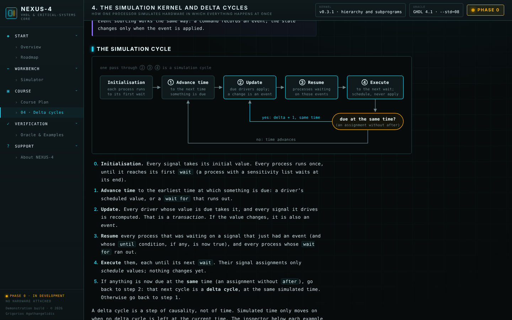
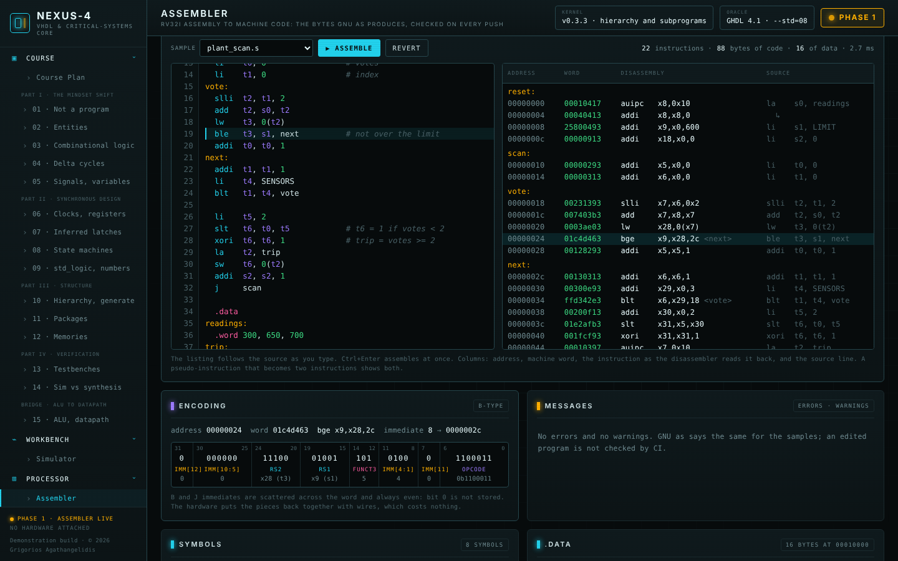
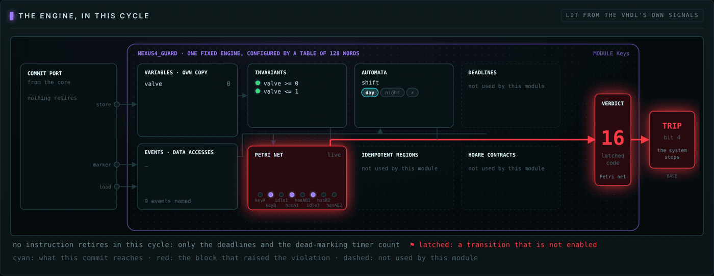
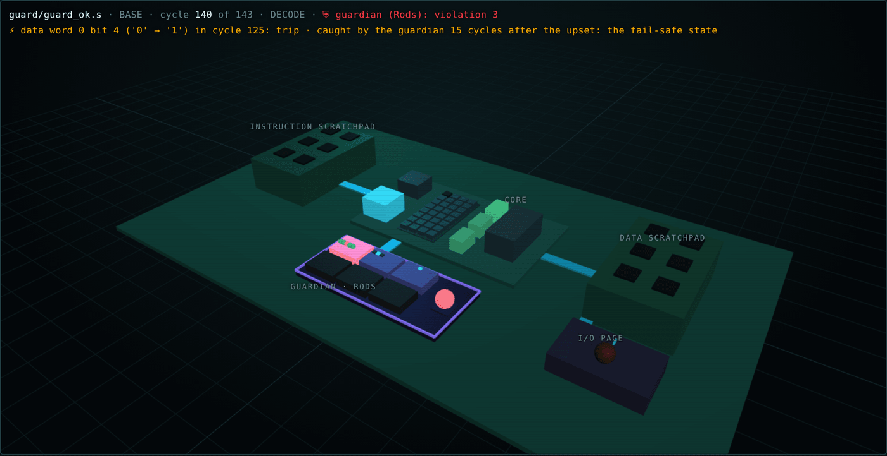

# NEXUS-4 — a processor you can watch, check and break

**One HTML file that teaches VHDL, runs a small RISC-V processor built for safety-critical systems, and shows a hardware *guardian* checking, while the program runs, that it keeps the rules of its formal specification.**

[](LICENSE)


[](https://github.com/gregory82gr/Nexus-4-phase-0/actions/workflows/differential.yml)

**[Open the live console](https://gregory82gr.github.io/Nexus-4-phase-0/)**, or download `index.html` and open it in a browser. Nothing to install, nothing to build, no server.

NEXUS-4 is written for software engineers who can program but have never designed hardware. You do not need to know how a processor works: this README and the course inside the console start from there.

It is the fourth system in the NEXUS series, and its processor is built for the first two:
- [NEXUS-1](https://github.com/gregory82gr/nexus1), the nuclear plant ([live demo](https://gregory82gr.github.io/Nexus-1-phase-0)): NEXUS-4 is the processor of its protection channel;
- [NEXUS-2](https://github.com/gregory82gr/Nexus-2-phase-0), the satellite constellation ([live demo](https://gregory82gr.github.io/Nexus-2-phase-0)): NEXUS-4 is the on-board computer of a satellite;
- [NEXUS-3](https://github.com/gregory82gr/Nexus-3-phase-0), the shared-memory multiprocessor ([live demo](https://gregory82gr.github.io/Nexus-3-phase-0)): NEXUS-4 is its opposite (see [Why](#why-nexus-4)).

> **Simulation only.** NEXUS-4 is a demonstration and study tool. Its processor has not been built on, or qualified for, any real device. It is not certified to any safety standard and must not be used to protect any real plant, vehicle or person. Standards are cited for orientation only (see [Standards awareness](#standards-awareness)).

---

## Why NEXUS-4

NEXUS-3 was about **hiding** time: out-of-order cores, caches, prefetching, everything that makes a processor fast on average. A critical system asks different questions:

- *Will this check always finish within its deadline?* Being fast on average does not answer that.
- *If a bit flips, or the software has a bug, will we know before it does harm?*

NEXUS-4 is built around those two questions. Its processor is slow and simple on purpose, so that its timing is a number you can compute, and everything about it can be watched and checked while it runs.

---

## What is in it

Three parts, each built on the one before:

| | Part | In one sentence |
|---|---|---|
| 1 | **A VHDL course** | Fifteen chapters that teach how to describe hardware, on a simulator that runs in the page and shows every step of the simulation. |
| 2 | **A processor** | A RISC-V processor written in that VHDL, running in the page, in two safety versions: one that stops safely (the plant), one that corrects itself and keeps going (the satellite). |
| 3 | **A guardian** | A small circuit beside the processor that checks, after every instruction, that the program keeps the rules of a formal specification written in TLA+. |

Everything you see in the console comes from running the VHDL itself, never from a separate drawing of what it should do. And every part is checked against an independent reference tool on every change (see [How we know it works](#how-we-know-it-works)).

---

## A tour of the console

The console is one page with a menu on the left. Here is one path through it.

**1. Learn what a hardware description is.** The course starts with *Hardware is not a program*: a circuit is not a list of steps but many parts working at once. Chapter 4 is the heart of it, the *simulation cycle*: how a simulator decides what changes when, in steps called *delta cycles* that take no time. Every chapter has examples you run and change in place, and a short quiz whose answers are computed by running the examples.



**2. Play with the simulator.** The *Simulator* page is a small VHDL workbench: write a design, run it, see its waveforms and step through each delta cycle with an explanation of what happened.


**3. Write a program.** The *Assembler* page turns instructions written as text (`addi a0, a0, 1`) into the 32-bit words the processor reads, shows the bits of each one, and runs the program on a reference model of the instruction set. The *Assembly Help* explains every instruction, with an encoder you can click bit by bit.



**4. Watch the processor work.** The *Core* page runs your program on the VHDL processor and shows it one clock cycle at a time: which wires carry what, which state the control is in, which register just changed, and a ✓ where the reference model agrees.


**5. Break it.** On the same page you can flip any bit of the running processor, as a particle from space would, and see what happens: nothing, a stop, or a wrong result nobody notices. Switch to the PLANT or ORBIT version and watch its protection catch the same upset. The *Fault Drills* ask you to predict the outcome before you run it.


**6. Meet the guardian.** The *Guardian* page shows the guardian checking a program cycle by cycle: the rules it was given in TLA+, what it remembers, and the moment a rule breaks. Its engine is drawn as a diagram that lights up as it works.



**7. See it as hardware.** *3D Hardware* shows the same run as chips and buses, with the guardian beside the core.



---

## The ideas, in plain words

### What a processor does

A processor runs a program one **instruction** at a time. An instruction is a 32-bit word that says one small thing: add two numbers, load a word from memory, jump if two numbers are equal. The processor keeps 32 **registers**, small named slots for the numbers it is working on, and a **program counter** (pc), the address of the next instruction. For each instruction it *fetches* the word at the pc, *decodes* it (which operation, which registers), *executes* it, and moves the pc on. A computer is built from millions of these steps.

**RISC-V** is an open instruction set: a free, public specification of which instructions exist and how they are encoded, used by many companies and universities. **RV32I** is its smallest complete part, 40 instructions on 32-bit registers. NEXUS-4 implements exactly those, plus one of its own for the guardian (`nx.mark`, below). Programs are written in **assembly language**, the instructions as text, which the assembler turns into words.

The processor itself is written in **VHDL**, a language that describes hardware. A VHDL design is not a program that runs line by line: it is a circuit, whose parts all work at once and change at the tick of a clock. That is why NEXUS-4 starts with a course.

### Why its timing is simple on purpose

In a desktop processor the same instruction can take one clock cycle or hundreds, depending on whether its data happens to be in a cache. For a reactor protection channel that is a problem: you must be able to say, before it runs, that the check always finishes in time.

So NEXUS-4 gives up speed for certainty. Its memories are **scratchpads** that always answer in the same time (no caches). It never guesses which way a branch will go. And it runs one instruction at a time on a fixed schedule: **every instruction takes 3 clock cycles, and a load from memory takes 4**. The worst-case execution time of a program is then a sum you can work out by hand, and on every program the tests check that the processor takes exactly that many cycles, not about that many.

### What can go wrong

Two kinds of fault:

- **Design errors.** A mistake in the processor or in the program. Every copy has it, and it happens the same way every time: a *systematic* fault.
- **Random upsets.** A particle from space, or from the environment, flips one bit of a register or a memory cell: a *single-event upset*. The circuit is fine; one value is wrong.

An upset may change nothing (it hit a value nobody uses), it may stop the processor (it turned an instruction into nonsense), or it may let the program finish normally with a wrong result. That last case, **silent data corruption**, is the dangerous one: in a protection channel, a silently wrong value is a trip that never happens. On NEXUS-4's unprotected core, about one upset in nine in its fault campaign did exactly that.

### Two answers: stop safely, or keep going

A reactor and a satellite want different things when something goes wrong, so the same VHDL builds two versions of the processor:

| | **PLANT** (the reactor's protection channel) | **ORBIT** (the satellite's on-board computer) |
|---|---|---|
| Goal | **Fail-safe**: when in doubt, stop. A *trip* shuts the reactor down, which is safe. | **Fail-operational**: a satellite cannot be stopped and inspected, so correct and continue. |
| Main protection | **Lockstep**: a second copy of the core runs the same program two cycles later, and their outputs are compared every cycle. Any difference trips. | **An error-correcting code**: seven extra bits on every word repair any single flipped bit, and detect two. |
| Also | **Parity** (one extra bit per memory word, which reveals a flipped bit), a **watchdog** (a timer the program must keep resetting, which catches a program that hangs), and a trip that stays once made. | **Scrubbing** (corrected words are rewritten in cycles nobody else needs, so errors do not pile up), **triple voting** on the program counter and the control (three copies, the majority wins), and **restarts** the program can see, so it can choose a safe mode. |
| Result in its fault campaign | 520 upsets: every one either harmless or a trip. No silent wrong result, no lost trip. | 360 upsets of what it protects: every one corrected, in exactly the same cycles. Protection costs no time. |

There is also **BASE**, the processor with no protection at all, to compare with.

### The guardian: a second, simpler opinion

Lockstep catches a flipped bit, but not a design error: two identical cores make the same mistake together. For that, NEXUS-4 follows the **Simplex** idea from safety engineering: next to the complex part (the processor and its software) stands a simple part that is easy to trust, and that steps in when the complex part breaks a rule.

The **guardian** is that simple part. It is a small circuit that runs no software. After every instruction, the processor reports what it did (the *commit port*), and the guardian watches two things in that report: the program's **stores** to memory, and **markers**, the program's own announcements of what it is doing (`nx.mark a0, 1` means "event 1 has happened, with the value in register a0"). From these it keeps its own copy of the variables that matter, and checks rules written in **TLA+**, a language for formal specifications.

For example, here is part of the rules for the control rods of a reactor (`tests/guard/Rods.tla`):

```tla
Map    == [pos |-> "rods", cmd |-> "command", trip |-> "tripped"]
Events == [Withdraw |-> 1, Insert |-> 2, Scram |-> 3, RodsIn |-> 4, Reset |-> 5]
Safety == /\ pos <= 40 /\ pos >= 0 /\ cmd - pos <= 5 /\ pos - cmd <= 5 /\ trip <= 1
RodsInOnTime == Within(scramAt, 90)
Withdraw == mode = "run" /\ UNCHANGED <<mode, scramAt>>
```

In words: three words of the program's memory mean *rod position*, *command* and *tripped* (the `Map`); the program announces five kinds of event; the position stays between 0 and 40 and never more than 5 steps from the command; after a *Scram*, the rods must be in within 90 cycles; and rods may be withdrawn only while the mode is "run". A translator in the page turns this module into a table of 128 words, and one fixed circuit checks whatever the table says. Six kinds of rule are possible:

| Kind of rule | Example | In hardware |
|---|---|---|
| **Invariants** | the command never more than 5 steps from the rods | comparisons of the variables, after every store |
| **Automata** | no *Withdraw* after a *Scram* until *Reset* | small state machines stepped by the events |
| **Deadlines** | after *Scram*, *RodsIn* within 90 cycles | counters |
| **A Petri net** | two operators and two keys of an interlock: nobody returns a key they do not hold, and the keys never deadlock | token counters, and a timer for a dead state |
| **Idempotent regions** | code that may safely run twice (after a restart) never overwrites what it read | two short lists of the words read and written |
| **Contracts** | `move(steps)` gets 0–5 steps and moves the rods by exactly that | checks at the function's entry and exit markers |

When a rule breaks, PLANT trips. ORBIT restarts the program and tells it why, so it takes its safe branch: the hardware decides the switch, as in Simplex.

**What it cannot do**, and the console shows each case: it cannot check "eventually" (a rule like "the rods will eventually go in" can never be shown broken in finite time; "within 90 cycles" can). It checks the rules, not the right answers: a wrong value the rules allow passes, and one of the drills is exactly that. And it sees only what the program reports; a forgotten marker is caught only when a deadline or an automaton expects it.

**Who checks the guardian?** The guardian's verdicts are compared with **TLC**, the standard model checker for TLA+, on every program: TLC replays what the processor did against the same TLA+ module and must reach the same verdict in the same cycle. And the guardian is itself protected against upsets: two copies compared in PLANT, three voted in ORBIT.

---

## The three parts in more detail

### Part 1 — The VHDL course

Fifteen chapters, in four parts: the mindset shift (a circuit is not a program; delta cycles; signals and variables), synchronous design (clocks, flip-flops, state machines, the nine values of `std_logic`), structure (hierarchy, packages, memories) and verification (testbenches; what becomes hardware and what exists only in simulation), with a last chapter that builds an ALU and a datapath and leads into the processor. Its examples come from the plant: a 2-out-of-3 trip vote, an alarm panel, a protection state machine that recovers from an upset.

It explains VHDL through ideas a software engineer already knows:

| VHDL | What you already know |
|---|---|
| Signal assignment | Recording an event: the change is scheduled, not applied |
| Delta cycle | A commit: all scheduled changes apply together and wake their handlers |
| Process | An event handler that reacts to changes |
| Variable | Local state inside the handler, updated at once |
| State machine | The states of an aggregate |

The simulator implements a documented subset of VHDL (VHDL-93 with a few VHDL-2008 features): what the processor needs, and what is needed to teach a trap. It is written in JavaScript, runs in the page, and agrees with GHDL, an established open-source VHDL simulator, delta cycle by delta cycle on all 44 examples of the course. Details: [the course](docs/ENGINEERING.md#part-1--the-vhdl-course-phase-0), [the simulator](docs/ENGINEERING.md#the-simulator-workbench-live), [the kernel](docs/ENGINEERING.md#kernel-status).

### Part 2 — The processor

- **The assembler** produces exactly the bytes the GNU assembler produces for the same program, and is a little stricter where GNU would silently change what you wrote. [Details](docs/ENGINEERING.md#the-assembler-live).
- **The reference model** describes the instruction set in about 250 lines of JavaScript, one instruction at a time. It agrees with Spike, the official RISC-V simulator, and passes the official RISC-V tests. [Details](docs/ENGINEERING.md#the-isa-reference-model-live).
- **The core** is the processor in VHDL: four states (fetch, decode, execute, and memory for loads), two scratchpads (instructions at `0x00000000`, data at `0x00010000`), and a small I/O page at `0x00020000` for sensors, the watchdog and the trip. It must commit every instruction exactly as the model does, in exactly the predicted number of cycles, on more than 150 programs (among them the official RISC-V tests). [Details](docs/ENGINEERING.md#the-rtl-core-live).
- **The assembly Help** is the reference for writing NEXUS-4 programs by hand: every instruction with its encoding and an example that runs, pseudo-instructions, traps, timing, 18 idioms, and a chapter on `nx.mark`. [Details](docs/ENGINEERING.md#the-assembly-help-live).
- **Fault injection** flips a bit of the running design at a chosen cycle. The PLANT and ORBIT campaigns above flip hundreds, at random and aimed, and say what each did. [Details](docs/ENGINEERING.md#fault-injection-phase-2-live), [PLANT](docs/ENGINEERING.md#the-plant-profile-live), [ORBIT](docs/ENGINEERING.md#the-orbit-profile-live).

### Part 3 — The guardian

The guardian is one fixed VHDL circuit (`nexus4_guard`) configured by a table, the way NASA's R2U2 monitors are, rather than new hardware for every specification. A property module in TLA+ becomes that table in the page; TLC checks the guardian's verdicts on 38 traces of 27 programs in `tests/guard`, written to keep each kind of rule and to break it. The Guardian page, the Core page, 3D Hardware and eight of the Fault Drills show it at work. [Details](docs/ENGINEERING.md#part-3--the-guardian-phase-3).

---

## How we know it works

No part of NEXUS-4 is trusted on its own word. Each is compared with an independent tool, on every change, by [GitHub Actions](.github/workflows/differential.yml):

| NEXUS-4 part | Compared with |
|---|---|
| The VHDL simulator | **GHDL**: every example, delta cycle by delta cycle |
| The assembler | **GNU binutils**: the same bytes and symbols; the disassembler against `objdump` |
| The reference model | **Spike**, instruction by instruction, and the official **riscv-tests** |
| The VHDL processor | **The reference model**, on every instruction and on the cycle count, on GHDL and on the page's own simulator |
| The guardian | **TLC**, the TLA+ model checker, on every trace |
| The protections | **Fault campaigns**: hundreds of upsets, each of which must end as the profile promises |

A test that cannot fail proves nothing. So for each tool there is a set of **mutations**, deliberate bugs put into a copy, and the tests must catch every one: 37 in the simulator, 26 in the assembler, 25 in the model, 81 in the processor and the guardian, 16 in the TLA+ translator. Even the quizzes in the course and the fault drills store no answers: each answer is computed by running the design.

### What the checks found along the way

Some of the most interesting results are mistakes the comparisons caught:

- **Two defects in GHDL itself.** Its trace leaves out some signals of an `if … generate` with alternatives, and it reads a constant array of records wrongly in one case. The page's simulator was right both times.
- **The GNU assembler does not use C's operator precedence**: `1 << 2 + 3` is 7 to GNU, 32 to C. Writing the Help, which had to explain the rule, found it.
- **A real hardware bug in ORBIT**: a watchdog that ran out in the very cycle of a restart asked for a second restart. Sweeping its timing against GHDL found it.
- **A rare hang**: among about 1,250 upsets searched, exactly one made the unprotected core loop forever.
- **A protection nothing tested**: PLANT's parity check before a byte is written into a word had no test and no mutation, until a test was written for it.
- **The guardian can be fooled by its own upset**: one flipped bit in its copy of the rod position let a broken rule pass, which is why it now has copies of its own.

---

## Roadmap

| Phase | Content | Status |
|---|---|---|
| 0 | The VHDL simulator, the workbench and the course | **Complete** |
| 1 | Assembler, reference model, the RV32I core, the Core page and the assembly Help | **Complete** |
| 2 | Fault injection, the PLANT and ORBIT versions, fault drills, 3D hardware | **Complete** |
| 3 | The guardian: the marker, the engine, TLA+ with TLC, Petri nets, idempotent regions, contracts, its own protection | **Complete** |
| 4 (optional) | A 5-stage pipeline as a refinement of the same core, with the same tests | Not started |

Each phase is complete and usable on its own. The full record of each is in [docs/ENGINEERING.md](docs/ENGINEERING.md#roadmap).

---

## Quick start

1. Open the [live console](https://gregory82gr.github.io/Nexus-4-phase-0/), or download `index.html` and open it in a current browser (Chrome, Edge, Firefox or Safari).
2. Start with the *Overview* page, which has a short tour, or go straight to *1. Hardware is not a program*.

Everything works offline except two things loaded from the web when available: Google Fonts (otherwise system fonts are used) and three.js for the *3D Hardware* page.

To run the checks yourself (Linux, Node 22, GHDL 4.1, GNU binutils for RISC-V, and for some of them Spike, riscv-tests and Java for TLC): see [running the tests locally](docs/ENGINEERING.md#continuous-integration-github-actions).

## The repository at a glance

```text
index.html            the whole console: HTML, CSS and JavaScript in one file
rtl/                  the processor and the guardian in VHDL
tests/examples/       the course's VHDL examples, each compared with GHDL
tests/asm, isa, core  programs for the assembler, the model and the core
tests/plant, orbit    programs for the two safety versions
tests/guard/          the guardian's TLA+ modules and the programs that keep or break them
tests/faults/         examples for checking fault injection against GHDL
tools/                the checks: comparisons with GHDL, GNU, Spike and TLC, fault campaigns, mutations
docs/                 screenshots, and ENGINEERING.md, the detailed record
```

The full list, file by file, is in [docs/ENGINEERING.md](docs/ENGINEERING.md#project-structure).

---

## Standards awareness

NEXUS-4 is shaped by the following documents. It claims compliance with none of them.

| Document | Relevance |
|---|---|
| IEEE 1076 (VHDL) | The language. NEXUS-4 implements a documented subset |
| RISC-V Unprivileged ISA specification | The instruction set of the core |
| IEC 62566 | Devices programmed in a hardware description language (FPGAs and similar) in nuclear instrumentation and control, for category A functions. It treats microprocessors as outside its scope and stresses simplicity and determinism; this is why the guardian, not the processor, carries the safety role in PLANT |
| ECSS-E-ST-20-40C, ECSS-Q-ST-60-03C | Space engineering and product assurance for ASIC, FPGA and IP cores (ORBIT) |

---

## Author

**Grigorios Agathangelidis** — electrical and software engineer and author of the NEXUS book series on Domain-Driven Design and formal methods ([Leanpub](https://leanpub.com/u/grigorios-kyriakos-agathangelidis)).

## Acknowledgements

- [GHDL](https://github.com/ghdl/ghdl), the reference VHDL simulator during development.
- GNU binutils for RISC-V, the reference assembler during development.
- [Spike](https://github.com/riscv-software-src/riscv-isa-sim), the RISC-V ISA simulator (BSD-3-Clause), the reference for the ISA model in CI; built from source, not distributed here.
- [riscv-tests](https://github.com/riscv-software-src/riscv-tests) (BSD-3-Clause), the official RISC-V tests, fetched by CI and not copied into this repository.
- [The TLA+ tools](https://github.com/tlaplus/tlaplus) (MIT License): TLC and SANY, fetched by CI at a pinned version.
- [three.js](https://threejs.org/) r128 (MIT License), loaded from cdnjs by the 3D Hardware page only.
- The RISC-V specifications published by RISC-V International.

NEXUS-4 is an independent project. It is not affiliated with, endorsed by or connected to RISC-V International, any processor vendor, any nuclear operator or regulator, or any space agency. RISC-V is a trademark of RISC-V International.

## License

Released under the [MIT License](LICENSE). Copyright © 2026 Grigorios Agathangelidis.
